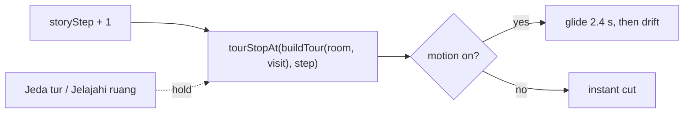

## 1. Delivery Metadata

| Field | Value |
|---|---|
| Session slot | `auto-tour` |
| Plan | `docs/code-plan/plans/2026-10-21-auto-tour.md` |
| Base branch | `main` (`38ded6e`) |
| Head branch | `2026-10-21-auto-tour/auto-tour` |
| Worktree | `/home/belajarcarabelajar/Proyek/time-capsule-wt/auto-tour` |
| Type of change | feature (auto-tour) and bug fix (profile picture, added by the owner as a side quest for the same PR) |
| Reviewer | independent read-only subagent, report in `docs/code-plan/evidence/2026-10-21-auto-tour/review-1.md` |

## 2. What This Changes

The 3D background now tours the matched room by itself: every dialogue line moves the camera to the next of eight tour stops, so the visitor watches the room from changing corners while pressing continue. With motion on the camera glides for 2.4 s and then drifts slowly while the line is read; with reduced motion or `Jeda gerakan` it cuts to the stop instead. A new `Jeda tur` / `Lanjutkan tur` button on the bar holds the current stop (WCAG 2.2.2 pause control). Separately, the Google profile picture now shows after login: the Pages CSP blocked it, and `UserBar` had no fallback when the image failed.

**Smallest visual:**

Tour stops come only from views the project already verified (wide and detail visit cameras, the three inspection views) plus orbits at 0.8 of the existing look-around limits, ordered so two close-ups never follow each other. The chapter's visit camera stays stop 0, so the arrival shot is unchanged.

**Non-goals:** AI-chosen shots per line (needs a scenario schema change); new hand-placed waypoints; a tour in poster mode; changes to dialogue, quiz, points, auth, or AI contracts.

## 3. Acceptance Criteria

| ID | Criterion (short) | Check | Evidence |
|---|---|---|---|
| AC1 to AC3 | 8 stops per room and visit, stop 0 is the visit camera, no repeated or consecutive close-ups, orbits inside limits, cycling step | `tourStops.test.js` | exit 0, 50 pass |
| AC4, AC5 | drift bounds; transition table (arrival, 2.4 s glide, 0.45 s glide, cut) | `cameraMotion.test.js` | exit 0, 18 pass |
| AC6 to AC8 | per-line stop prop and attributes, pause holds and resumes, storage, toggle hidden where it must be, toggle never advances the lesson | `AutoTour.test.jsx` | exit 0, 15 pass |
| AC9 | reduced motion: a different view per line; motion on: the stop advances | `auto-tour.spec.js` (Chromium) | exit 0, 3 passed, 1 skipped (sweep runs only with `TOUR_SHOTS`) |
| AC10 | existing arrival, skip, explore, inspect, reduced-motion, blocked behavior | `bun test src/immersive`, immersive, enrichment (desktop and 390 px), journeys, fallback e2e | all exit 0 (Chromium) |
| AC11 | every stop in all 8 rooms reviewed for clipping | visual sweep (SwiftShader and GPU) | 64 settled and 64 mid-glide frames reviewed, exit 0 |
| T7 | profile picture loads after login; failed picture falls back to the initial | `UserBar.test.jsx`, `build-website.test.js`, `profile-avatar.spec.js` | exit 0 (13, 14, 2) |

## 4. Local Verification Evidence

CI is disabled for this repository; every row ran locally. Full log: `docs/code-plan/evidence/2026-10-21-auto-tour/verification.md`.

| Gate | Command | Exit | Result |
|---|---|---|---|
| Web unit | `bun run --cwd apps/web test` | 1 | 277 pass, 10 fail; the same 10 fail on `main` (196 pass, 10 fail), pre-existing cross-file isolation in `AuthContext` and balance refresh tests |
| Other packages | turbo `test` | 0 | game-engine 118, story-worker 44, ui pass |
| Backend | `bun run test:backend` | 0 | 97 pass |
| Root scripts and CSP | `bun run test:script` | 0 | 14 pass |
| Room assets | `bun run test:assets` | 0 | 8 rooms verified |
| Lint | `bun run --cwd apps/web lint` | 0 | clean |
| Build | `bun run build` | 0 | completed |
| Client assets | `bun run test:client-assets` | 0 | 53 files, no credential markers |
| Copy rules | `bun ~/vivera/scripts/check-copy-rules.mjs --diff origin/main` | 0 | clean |

Browser runs use `/usr/bin/chromium` through scratch wrapper configs, because this machine has no Playwright-bundled browser; WebKit is not available here.

- **Before (auto-tour):** `auto-tour.spec.js` on the base code exit 1; `data-tour-stop` was `null` on all nine lines.
- **After:** exit 0, 3 passed.
- **Before (profile picture):** `profile-avatar.spec.js` with the `origin/main` `_headers` exit 1, the avatar never loaded (`Expected: true, Received: false`); production serves the same `img-src 'self' data: blob:`.
- **After:** exit 0, 2 passed; only the `img-src` line differs between the two runs.
- **Visual sweep:** every tour stop in all 8 rooms was rendered and reviewed frame by frame: 64 settled frames (reduced motion) and 64 mid-glide frames on the laptop GPU (`--use-angle=gl-egl`, 64 of 64 in 3D), no camera inside geometry (`visual-sweep.md` and the contact sheets next to it). Under SwiftShader only 11 of 64 mid-glide frames rendered before the frame monitor switched to the poster. Drift extremes were not rendered.

## 5. Independent Review

- [x] An independent read-only reviewer audited `origin/main...HEAD`: verdict `correct`, no P0 or P1; two P2 and three P3 findings, all resolved or recorded (`review-1.md`).
- [x] Parent diff audit after every chunk: diffs read, targeted tests re-run in the parent before each commit, commits staged by explicit path.

## 6. Risks

| Risk | Door | Mitigation |
|---|---|---|
| Motion discomfort from per-line camera moves | two-way (revert) | reduced motion cuts, `Jeda gerakan`, `Jeda tur` |
| A glide path crosses a prop in one room | two-way | settled stops reviewed in all 8 rooms; reorder that room's stops |
| A Google account served from a host other than `lh3.googleusercontent.com` | two-way | `onError` falls back to the initial |
| CSP change widens image loading | two-way | one exact host, asserted by `build-website.test.js` |

## 7. Follow-ups (not in this PR)

Listed in the plan's follow-up backlog (F1 to F9): no Playwright-bundled browser locally, two remote background textures blocked by the same CSP in legacy non-immersive mode, WebKit unavailable locally, SwiftShader poster fallback, pause freezing at the drift offset, the pre-existing 10 web test isolation failures, and two pre-existing camera edge cases found by the reviewer.
