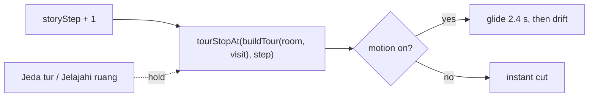

## 1. Delivery Metadata

| Field | Value |
|---|---|
| Session slot | `auto-tour` |
| Plan | `docs/code-plan/plans/2026-10-21-auto-tour.md` |
| Base branch | `main` (`38ded6e`) |
| Head branch | `2026-10-21-auto-tour/auto-tour` |
| Worktree | `/home/belajarcarabelajar/Proyek/time-capsule-wt/auto-tour` |
| Type of change | feature (auto-tour), test and tooling fixes from the debt sweep; the profile picture fix itself landed in #48 |
| Reviewer | independent read-only subagent, report in `docs/code-plan/evidence/2026-10-21-auto-tour/review-1.md` |

## 2. What This Changes

The 3D background now tours the matched room by itself: every dialogue line moves the camera to the next of eight tour stops, so the visitor watches the room from changing corners while pressing continue. With motion on the camera glides for 2.4 s and then drifts slowly while the line is read; with reduced motion or `Jeda gerakan` it cuts to the stop instead. A new `Jeda tur` / `Lanjutkan tur` button on the bar holds the current stop (WCAG 2.2.2 pause control). The profile picture side quest started here, but the owner chose PR #48 (merged as `c56f00b`) to carry that fix; this branch merged `main` and keeps only `profile-avatar.spec.js`, a browser check that the avatar loads under the real `img-src` and falls back to the initial, which passes against #48's behavior.

**Smallest visual:**

Tour stops come only from views the project already verified (wide and detail visit cameras, the three inspection views) plus orbits at 0.8 of the existing look-around limits, ordered so two close-ups never follow each other. The chapter's visit camera stays stop 0, so the arrival shot is unchanged.

**Non-goals:** AI-chosen shots per line (needs a scenario schema change); new hand-placed waypoints; a tour in poster mode; changes to dialogue, quiz, points, auth, or AI contracts.

## 3. Acceptance Criteria

| ID | Criterion (short) | Check | Evidence |
|---|---|---|---|
| AC1 to AC3 | 8 stops per room and visit, stop 0 is the visit camera, no repeated or consecutive close-ups, orbits inside limits, cycling step | `tourStops.test.js` | exit 0, 50 pass |
| AC4, AC5 | drift bounds; transition table (arrival, 2.4 s glide, 0.45 s glide, cut) | `cameraMotion.test.js` | exit 0, 18 pass |
| AC6 to AC8 | per-line stop prop and attributes, pause holds and resumes, storage, toggle hidden where it must be, toggle never advances the lesson | `AutoTour.test.jsx` | exit 0, 15 pass |
| AC9 | reduced motion: a different view per line; motion on: the stop advances | `auto-tour.spec.js` (Chromium) | exit 0, 3 passed, 1 skipped (sweep runs only with `TOUR_SHOTS`) |
| AC10 | existing arrival, skip, explore, inspect, reduced-motion, blocked behavior | `bun test src/immersive`, immersive, enrichment (desktop and 390 px), journeys, fallback e2e | all exit 0 (Chromium) |
| AC11 | every stop in all 8 rooms reviewed for clipping | visual sweep (SwiftShader and GPU) | 64 settled and 64 mid-glide frames reviewed, exit 0 |
| T7 | profile picture loads after login; failed picture falls back to the initial (fix in #48) | `profile-avatar.spec.js` against the merged `main` | exit 0, 2 passed |

## 4. Local Verification Evidence

CI is disabled for this repository; every row ran locally on the merged tree (`513ce33`). Full log: `docs/code-plan/evidence/2026-10-21-auto-tour/verification.md`.

| Gate | Command | Exit | Result |
|---|---|---|---|
| Quality gate | `bun run test:quality` | 0 | web 302 + 2, ui 60, game-engine 118, story-worker 45, backend 97, script 16, assets 8 rooms; 0 fail |
| Lint | `bun run --cwd apps/web lint` | 0 | clean |
| Build | `bun run build` | 0 | completed |
| Client assets | `bun run test:client-assets` | 0 | clean |
| Copy rules | `bun ~/vivera/scripts/check-copy-rules.mjs --diff origin/main` | 0 | clean |
| Browser (Chromium) | `PLAYWRIGHT_CHROMIUM=/usr/bin/chromium` with tour, profile, immersive, enrichment, journeys, fallback configs | 0 each | 3 (+1 skipped), 2, 11, 18, 4, 1 passed |

This laptop has no Playwright-bundled browser; `PLAYWRIGHT_CHROMIUM` (new in this PR) points the configs at the system Chromium, and WebKit projects are not run here.

- **Before (auto-tour):** `auto-tour.spec.js` on the base code exit 1; `data-tour-stop` was `null` on all nine lines.
- **After:** exit 0, 3 passed.
- **Profile picture:** before #48, `profile-avatar.spec.js` with the old `img-src 'self' data: blob:` exit 1 (`Expected: true, Received: false`), the same header production served; against `main` after #48 it passes (exit 0, 2 passed).
- **Visual sweep:** every tour stop in all 8 rooms was rendered and reviewed frame by frame: 64 settled frames (reduced motion) and 64 mid-glide frames on the laptop GPU (`--use-angle=gl-egl`, 64 of 64 in 3D), no camera inside geometry (`visual-sweep.md` and the contact sheets next to it). Under SwiftShader only 11 of 64 mid-glide frames rendered before the frame monitor switched to the poster. Drift extremes were not rendered.

## 5. Independent Review

- [x] An independent read-only reviewer audited `origin/main...HEAD`: verdict `correct`, no P0 or P1; two P2 and three P3 findings, all resolved or recorded (`review-1.md`).
- [x] Parent diff audit after every chunk: diffs read, targeted tests re-run in the parent before each commit, commits staged by explicit path.

## 6. Risks

| Risk | Door | Mitigation |
|---|---|---|
| Motion discomfort from per-line camera moves | two-way (revert) | reduced motion cuts, `Jeda gerakan`, `Jeda tur` |
| A glide path crosses a prop in one room | two-way | settled stops reviewed in all 8 rooms; reorder that room's stops |
| CSP change widens image loading | two-way | one exact host, asserted by `build-website.test.js` |

## 7. Debt sweep follow-ups done in this PR

| Task | Change | Evidence |
|---|---|---|
| T8 | `PLAYWRIGHT_CHROMIUM` and `PLAYWRIGHT_GPU=1` in `apps/web/playwright.launch.js`, used by every Playwright config; unchanged defaults | `test:script` exit 0; configs exit 0 with the variable, launch error unchanged without it |
| T9 | test: every Playwright config serves on its own port; it found immersive and fallback both on 5173, fallback moved to 5178 | `test:script` exit 0 |
| T10 | the 10 web tests that failed on `main` too: `useGameState.test.jsx` replaced `AuthContext` with `mock.module` for the whole bun process; now a spy restored after each test | `bun run test` in `apps/web` exit 0, 302 pass |
| T11 | removed the two `transparenttextures.com` backgrounds the CSP already blocked (legacy non-immersive mode) | StartScreen and ui tests exit 0 |
| T12 | a tab hidden mid-arrival replayed the arrival on return; it now ends it, like a blocked lesson | RED exit 1, then `AutoTour.test.jsx` exit 0 |
| T13 | `Jeda tur` glides 0.45 s onto the exact stop instead of freezing at the drift offset | RED exit 1, then `cameraMotion.test.js` exit 0 |

## 8. Follow-ups (not in this PR)

Plan backlog: WebKit cannot run on this laptop (F3); keyboard look offsets cut instead of the exit glide (F9, pre-existing); a dead `mock.module('../utils/history')` path in `useGameState.test.jsx` (F10); the pause settle glide is unit-tested only (F11).
