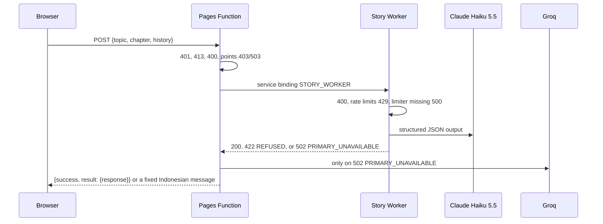

## 1. Delivery Metadata

| Field | Value |
|---|---|
| Session slot | `claude-story-worker` |
| Plan | `docs/code-plan/plans/2026-10-21-claude-story-worker.md` |
| Spec | `docs/code-plan/specs/2026-10-21-claude-story-worker-design.md` |
| Base branch | `main` |
| Head branch | `2026-10-21-claude-story-worker/claude-story-worker` |
| Type of change | feature (breaking for the `/api/scenario` request body) |
| Reviewer | independent read-only reviewer, two rounds (reports in `docs/code-plan/evidence/2026-10-21-claude-story-worker/`) |

## 2. What This Changes

Story chapters are now written by Claude Haiku 5.5 (`claude-haiku-5-5`, effort `medium`) through a new private Worker, `time-capsule-story`, and the existing Groq provider becomes the fallback. The browser no longer sends a prompt: it posts only `{topic, chapter, history}`, and the server validates that request, builds the prompt, and fixes the model, token cap, and output format. Before this change any signed-in visitor could send their own system prompt and `max_tokens` through `/api/scenario`, which made it an open model proxy. The Worker has no public URL, applies two rate limits, and holds the Claude key as its only secret. A Claude refusal or a throttled request ends with a clear message to the visitor and no charge; only a Claude availability failure reaches Groq.

**Non-goals:** binding a D1 database to the production Pages project (today only the verified admin can generate there); removing unused legacy Pages secrets; storing story history on the server; streaming; a spend limit in the Anthropic Console.

## 3. Acceptance Criteria

| ID | Criterion | Task | Check | Evidence |
|---|---|---|---|---|
| AC1 | Body is exactly `{topic, chapter, history}`; other keys, out-of-range chapter, empty topic, oversized text give 400 with no Worker call and no charge | T1, T3 | `bun test packages/game-engine/src/__tests__/scenarioPrompt.test.js`; `bun test functions/api/scenario.test.js` | exit 0, 70 pass; exit 0, 49 pass |
| AC2 | Body over 16384 bytes gives 413 | T3 | `bun test functions/api/scenario.test.js` | exit 0 (ASCII and multibyte cases) |
| AC3 | The browser sends no prompt, model, token cap, or format | T4 | `bun test packages/game-engine/src/__tests__/scenarioClient.test.js` | exit 0, 20 pass |
| AC4 | Claude call: `claude-haiku-5-5`, `max_tokens` 16000, adaptive thinking, `output_config` effort `medium` with `json_schema`, no sampling parameters, no `fallbacks` | T2 | `bun test apps/story-worker/src/index.test.js` | exit 0, 44 pass (captured request body) |
| AC5 | Only Worker 502 `PRIMARY_UNAVAILABLE` reaches Groq, with the same server-built prompt | T3 | `bun test functions/api/scenario.test.js` | exit 0 |
| AC6 | 422 `REFUSED` and 429 `RATE_LIMITED` never reach Groq or charge, and the visitor sees the server message | T3, review fix | `scenario.test.js`; `cd apps/web && bun test src/hooks/__tests__/useGameState.test.jsx` | exit 0; exit 0, 18 pass |
| AC7 | Missing binding, thrown call, or unknown Worker reply fail closed | T3 | `bun test functions/api/scenario.test.js` | exit 0 |
| AC8 | 6 per 60 s per account and 20 per 60 s site-wide, after validation and before Claude | T2 | `bun test apps/story-worker/src/index.test.js` | exit 0 |
| AC9 | No provider text, exception message, key, prompt, or user id in replies or logs | T2, T3 | Worker and Pages leak cases | exit 0 |
| AC10 | `workers_dev: false`, `preview_urls: false`, no route | T2 | config test in `index.test.js` | exit 0; post-deploy host check is a separate gated step |
| AC11 | Claude key never in browser code or the browser bundle | T6, review fix | `bun run test:script`; `grep -rqF sk-ant apps/web/dist` | exit 0, 13 pass; exit 1 (no match) |
| FU-1 | 403 and 503 points messages are shown; a reply without a JSON message never shows a bare code | T9 | `cd apps/web && bun test src/hooks/__tests__/useGameState.test.jsx` | exit 0, 18 pass |
| FU-2 | A declared `Content-Length` over 16384 gets 413 before the body is read | T10 | `bun test functions/api/scenario.test.js` | exit 0, 49 pass |
| FU-3 | The CI lint step runs eslint; a test rejects the no-op `bun --cwd <dir> run` form | T11 | `bun run test:script`; `bun run --cwd apps/web lint` | exit 0, 13 pass; exit 0, `$ eslint .` |
| FU-4 | The former `packages/game-engine/tests/` file runs under the package test script | T12 | `bun test packages/game-engine/src/__tests__/scenarioClientPrompt.test.js` | exit 0, 4 pass |

## 4. Local Verification Evidence

All rows ran on the machine holding the working tree at `ebd6fd4` (code unchanged since), before the push that carries them.

| Gate | Command | Exit | Result |
|---|---|---|---|
| Workspace tests | `bun run test` | 1 | game-engine 118 pass, story-worker 44 pass, ui 57 pass, web 196 pass and 10 fail (pre-existing, section 7) |
| Backend tests | `bun run test:backend` | 0 | 97 pass, 0 fail |
| Script tests | `bun run test:script` | 0 | 13 pass, 0 fail |
| Asset checks | `bun run test:assets` | 0 | every room OK |
| Lint | `bun run --cwd apps/web lint` | 0 | 0 errors, 0 warnings |
| Build | `bun run build` | 0 | completed, 0 warnings |
| Client assets | `bun run test:client-assets` | 0 | passed |
| Worker bundle | `bun run --cwd apps/story-worker check` | 0 | `Total Upload: 904.91 KiB / gzip: 157.68 KiB`, both rate-limit bindings listed |
| Pages Functions bundle | `./node_modules/.bin/wrangler pages functions build functions --outdir .wrangler/tmp/pages-functions-check` | 0 | compiled |

- **Before:** `scenario.test.js` against the old handler: exit 1, 36 of 40 fail (for example "Expected: 413, Received: 200"); the hook test against the old hook: exit 1, 3 fail (fixed string shown for 422 and 429).
- **After:** the same files exit 0 with 40 and 12 pass.

Full log: `docs/code-plan/evidence/2026-10-21-claude-story-worker/verification.md`.

## 5. Independent Review

- [x] A reviewer that did not produce the work read the diff (two rounds).
- [x] The parent diff audit ran: every chunk's `git diff` inspected and its targeted tests re-run in the parent before staging by explicit path.
- [x] Every qualifying finding is fixed in this PR: one P1 (visitor never saw the 422 and 429 messages) and three P3 (sanitizer lookalikes, no reversal test for AC11, `unknown` failures logged without a status).
- [x] Debt-sweep follow-ups FU-1 to FU-4 were audited in the parent (diff read, targeted tests re-run) before staging; the audit caught one defect in FU-1 (a bare `POINTS_UNAVAILABLE` code shown to the visitor), fixed in the same commit.

**Reviewer verdict:** `correct` (confidence 0.85). It would change on a full-suite failure in a touched file, or if the gated deploy shows the rate-limit binding rejected, the Worker reachable on `workers.dev`, or every smoke call logging `reason: unknown`.

## 6. Risk, Rollout, Rollback

| Concern | Answer |
|---|---|
| Blast radius | Every story generation on the site. |
| Door | Two-way: a revert of the merge plus a Pages redeploy restores the Groq-only flow. |
| Rollout | Gated, in order: deploy the Worker, set its `ANTHROPIC_API_KEY` secret, confirm the `workers.dev` host does not serve it, add the `STORY_WORKER` service binding to Pages production, deploy Pages. Deploying Pages before the binding exists makes every generation return 500 `STORY_UNAVAILABLE` (fail closed). |
| Health signal | `wrangler tail time-capsule-story` shows `outcome: "ok"` with token counts while a chapter loads; `/api/scenario` returns 200 and the chapter renders. |
| Rollback | `git revert -m 1 <merge commit>` and `bash scripts/deploy-website.sh`; then remove the Pages binding and `wrangler delete --name time-capsule-story`. |
| Compatibility | Browser tabs loaded before the deploy still send `messages` and get 400 until reloaded. The success reply shape is unchanged. The Claude key expires on 2026-11-20; afterwards the Worker reports `PRIMARY_UNAVAILABLE` with reason `auth` and Groq serves. |

## 7. Pre-Existing Issues and Deferred Debt

- `apps/web/src/context/__tests__/`: 10 `AuthContext` tests fail on `main` at `14cc4db` with the same names (fail-set `diff` exit 0), and GitHub Actions has been red on them since at least `386c664`. `defer: separate pull request (AGENTS.md A7), when the owner schedules it`.
- Fixed here as FU-3: `.github/workflows/quality.yml` ran lint as `bun --cwd apps/web run lint`, which prints Bun usage and exits 0 on bun 1.4.3 and on the CI pin 1.4.2, so CI never ran eslint. With this PR the step lints for real; the tree has 0 findings.
- Production Pages has no D1 binding, so only the verified admin account can generate. `defer: owner decision on creating the D1 database, when non-admin play is wanted`.
- No Analytics Engine metric for Worker 429 replies. `defer: add when traffic needs a dashboard`.
- Root `packageManager` pins `bun@1.4.2` while local machines run 1.4.3. `defer: bump with the repository-wide pin, when CI moves to 1.4.3`.
