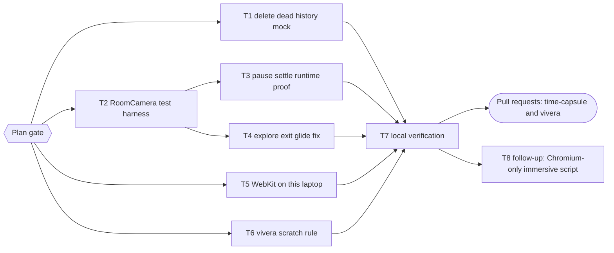

# Auto-Tour Backlog Implementation Plan

> For agentic workers: REQUIRED EXECUTION METHOD: delegated task execution (recommended) or inline plan execution. Steps use checkbox syntax.

**Goal:** Close the five items left in the backlog of `docs/code-plan/plans/2026-10-21-auto-tour.md` (F10, F11, F9, F3, and the scratch-folder rule for vivera).

**Architecture:** One web session (`auto-tour-backlog`, PR in time-capsule) for T1 to T5 and T7, plus one vivera session (`scratch-rule`, PR in vivera) for T6. A new RoomCamera test harness (T2) mocks `@react-three/fiber`'s `useThree` and `useFrame` at the framework boundary in its own bun process, the same isolation the web `test` script already gives `RoomModel.test.jsx`, so the camera wiring finally gets runtime tests without a new dependency (rejected option: `@react-three/test-renderer@8.2.4`, MIT, peer fiber 8; a supply-chain addition for the same proof).

**Tech Stack:** Bun 1.4, React 18, `@react-three/fiber` 8.18, three 0.170, `bun:test` with happy-dom, Playwright 1.63.

**Active Project Profile:**
- Repository root `/home/belajarcarabelajar/Proyek/time-capsule`; worktree `/home/belajarcarabelajar/Proyek/time-capsule-wt/auto-tour-backlog`, branch `2026-10-21-auto-tour-backlog/auto-tour-backlog`, base `origin/main` at `4aa4e71`.
- vivera: `/home/belajarcarabelajar/vivera`, its own claimed worktree for T6 (claimed at execution).
- CI disabled; local gate only. Browser runs need `PLAYWRIGHT_CHROMIUM=/usr/bin/chromium` on this laptop.

**Protected Boundaries:** tour behavior and its tests from PR #47; the `useGameState.test.jsx` spy fix (T10 of the previous plan); RoomModel's separate bun process.

**Scope:** F10 dead mock, F11 runtime proof of the pause settle, F9 explore exit glide, F3 WebKit locally, the vivera contract template rule.

**Non-Goals:** new camera behavior beyond F9; installing Playwright's Chromium (the system Chromium override already covers it); CI changes.

**Visual Map:**

**Reasoning Lenses:** investigative (F9 traced to `RoomCamera.jsx:86-93`: on explore exit the offset reset cuts after the view effect started a 0.45 s glide); test-first; compatibility (WebKit on Arch is not a Playwright-supported Linux); supply chain (no new dependency); verification.

**Acceptance Criteria:**
- AC1: `useGameState.test.jsx` has no `mock.module('../utils/history', ...)`; a test named "uses the real history summary" proves the hook calls the real helper; `bun run test` in `apps/web` exit 0.
- AC2: `RoomCamera.test.jsx` drives RoomCamera with a fake `useThree` (a real three `PerspectiveCamera`, a stub `gl.domElement`, `invalidate`) and a manual frame clock from a fake `useFrame`; it runs in its own bun process from the web `test` script; a "harness" test proves a tour stop change glides (camera between poses at 1.2 s, on the stop at 2.4 s) and motion off cuts.
- AC3: "settles": with drift on the camera leaves the stop; after drift turns off it is exactly on the stop 0.45 s later; a mutation that removes the settle effect turns the test red.
- AC4: "exit glide": after keyboard look offsets while exploring, leaving explore glides 0.45 s back to the stop (between poses at 0.2 s) instead of cutting; red before the fix, green after; keyboard look-around while exploring still applies immediately.
- AC5: WebKit: either `--project webkit` of the immersive config exits 0 on this laptop after `bunx playwright install webkit`, or the exact launch error is recorded, the README states that WebKit runs only on Playwright-supported Linux, and the installed browser is removed again.
- AC6: vivera `templates/subagent-contract-template.md` gives every subagent its own scratch subfolder (`$HOME/.cache/tmp/<project>-scratch/<chunk-id>/`) and limits its cleanup to it; `bun run ci:targeted` in vivera exit 0.
- AC7: local gate exit 0 (`test:quality`, lint, build, tour e2e).

**Assumptions & Open Questions:**
- Assumption: mocking `@react-three/fiber` hooks with `mock.module` is safe only in its own bun process (the process-wide leak found in the previous plan's T10); T2 adds the file to the separate run like `RoomModel.test.jsx`.
- Assumption: T5 downloads Playwright's WebKit into `~/.cache/ms-playwright` (about 100 MB, machine change approved with this plan); revert `rm -rf ~/.cache/ms-playwright/webkit-*`.
- Open: none blocking.

**Risks & Rollback:** T4 touches the camera; rollback is reverting its commit. T5 is local only. T6 is a separate vivera PR.

**Definition of Done:** T1 to T7 green with exit codes, two PRs open and registered, the previous plan's backlog rows F3, F9, F10, F11 marked closed with links.

**Plan Status & Version:** Approved by the owner on 2026-10-21 (Plan gate), version 1.

## Global Constraints

- No new npm dependency. No em dash; no attribution trailer.
- Each subagent gets its own scratch subfolder under `$HOME/.cache/tmp/time-capsule-scratch/` (M8).

### Task T1: delete the dead history mock

`apps/web/src/hooks/__tests__/useGameState.test.jsx:35` mocks `../utils/history`, which resolves to the missing `src/hooks/utils/history`; nothing asserts `'mocked history'`. Repointing it would add a process-wide module mock (the leak class fixed in PR #47), so delete it and add a test that the hook uses the real helper.

- [x] Step 1: add "uses the real history summary" and delete the mock | `cd apps/web && bun test src/hooks/__tests__/useGameState.test.jsx` exit 0
- [x] Step 2: `cd apps/web && bun run test` exit 0
- [x] Step 3: Commit (parent) by path.
- Evidence: `a00ba49`; the new test passed with the dead mock (proving it never applied) and failed (exit 1) when the mock was temporarily repointed to the real module; `useGameState.test.jsx` exit 0 (23 pass); `bun run test` exit 0.

### Task T2: RoomCamera test harness

New `RoomCamera.test.jsx`: `mock.module('@react-three/fiber', ...)` returns `useThree` with a real `PerspectiveCamera`, a stub canvas element, and `invalidate`, and `useFrame` that registers the callback so the test advances time by hand. Add it to the web `test` script's separate run (next to `RoomModel.test.jsx`), so its module mock cannot leak.

- [x] Step 1: harness tests for a 2.4 s glide on a tour stop change and a cut with motion off | exit 0 (behavior exists; prove red by mutating `TOUR_GLIDE_SECONDS` once and restoring)
- [x] Step 2: update the `test` script; `cd apps/web && bun run test` exit 0; `bun run test:script` exit 0
- [x] Step 3: Commit (parent) by path.
- Evidence: `e139209`; mutation `TOUR_GLIDE_SECONDS = 0.1` turned the glide test red (exit 1), restored (`cmp` exit 0); `RoomCamera.test.jsx` exit 0; web `test` script now runs it in its own process; `bun run test` exit 0; `test:script` exit 0.

### Task T3: pause settle runtime proof

- [x] Step 1: "settles" test in `RoomCamera.test.jsx` | exit 0; mutation without the settle effect | exit 1; restore and diff against a pristine copy
- [x] Step 2: Commit (parent) by path.
- Evidence: `bcf5b5c` (shares the test file with T4); removing the settle effect left the camera 0.658 off the stop (exit 1), restored (`cmp` exit 0); `RoomCamera.test.jsx` exit 0 (5 pass).

### Task T4: explore exit glide

Today, leaving explore resets `viewOffset` and the `viewOffset` effect (`RoomCamera.jsx:86-93`) cuts, cancelling the 0.45 s glide the view effect started. Fix with a pure `shouldApplyLookOffset({ previous, next, exploring })` in `cameraMotion.js` (apply only while exploring and changed) used by that effect.

- [x] Step 1: RED "exit glide" in `RoomCamera.test.jsx` and the table test in `cameraMotion.test.js` | exit 1
- [x] Step 2: implement | both files exit 0; `bun test src/immersive` exit 0
- [x] Step 3: Commit (parent) by path.
- Evidence: `bcf5b5c`; RED exit 1 (camera already on the stop at 0.2 s, the cut) and `shouldApplyLookOffset` missing; GREEN `RoomCamera.test.jsx` exit 0 (5), `cameraMotion.test.js` exit 0 (26), `bun test src/immersive` exit 0 (230), eslint exit 0.

### Task T5: WebKit on this laptop

Playwright supports WebKit on Ubuntu and Debian, not Arch, so this is a probe with a recorded outcome.

- [x] Step 1: `cd apps/web && bunx playwright install webkit` | record exit
- [x] Step 2: immersive `--project webkit` | exit 0 means F3 closed; otherwise record the first launch error, remove `~/.cache/ms-playwright/webkit-*`, and add one README sentence that WebKit runs only on Playwright-supported Linux
- [x] Step 3: Commit (parent) by path.
- Evidence: `0c283ee`; `bunx playwright install webkit` exit 0 (`webkit-2359`, 294 MB), immersive `--project webkit` exit 1, 11 failed at launch: the Ubuntu build needs ICU 74 (Arch has 78), `libxml2.so.2` (Arch ships `.so.16`), and flite. Download removed again; README states WebKit needs a Playwright-supported Linux. F3 stays a documented environment limit.

### Task T6: vivera scratch rule

In the vivera session worktree: add a "Scratch folder" row to section 1 of `templates/subagent-contract-template.md` (own subfolder, cleanup limited to it), then `bun run ci:targeted` exit 0 and `check-copy-rules` exit 0; open the vivera PR.

- [x] Step 1: edit and checks
- [x] Step 2: Commit and PR in vivera (parent).
- Evidence: vivera `1c949ac`, PR belajarcarabelajar/vivera#155; `bun run ci:targeted` exit 0 (validate-skill, file-size, 745 tests, copy-rules PASS).

### Task T7: local verification

- [x] Step 1: run the `run[]` commands; record exit codes in `docs/code-plan/evidence/2026-10-21-auto-tour-backlog/verification.md`.
- Evidence: `docs/code-plan/evidence/2026-10-21-auto-tour-backlog/verification.md`; every gate step exit 0.

### Task T8: Chromium-only immersive script (debt-sweep follow-up)

Selected by the owner at the debt sweep (2026-10-21): `test:immersive` runs the WebKit project too, which always fails at launch on Arch (T5). Add `test:immersive:chromium` and point the README at it.

- [x] Step 1: script and README | `PLAYWRIGHT_CHROMIUM=/usr/bin/chromium bun run --filter web test:immersive:chromium` exit 0
- [x] Step 2: Commit (parent) by path.
- Evidence: `PLAYWRIGHT_CHROMIUM=/usr/bin/chromium bun run --filter web test:immersive:chromium` exit 0 (11 passed). The first attempt used the README's `bun --filter web run` form, which exits 1 on bun 1.4.3 (`Script "run" not found`); with the owner's approval (same-class question) all nine other doc lines moved to `bun run --filter web <script>`, each form proven (`--list` exit 0 for the four browser scripts, `dev` reached `ready in 447 ms`).

## Closeout status

- Owner answer at the debt sweep (2026-10-21): **Keep it open**; follow-up T8 selected.
- Readiness (`--cwd` the time-capsule worktree, because without it the tool picked the vivera session's worktree): NEEDS-HUMAN; T1 to T4 DONE, T5 to T7 UNPROVEN (`skip_if: "false"`), evidence in `docs/code-plan/evidence/2026-10-21-auto-tour-backlog/verification.md`.
- Backlog (LATER): `useGameState.test.jsx` is 18.2 KB, 91% of vivera's 20 KB file-size default; defer: split it when an edit pushes it past 20 KB. vivera `plan-closeout.mjs --readiness` picks the newest unfinished session's worktree even when that session lives in another repository; defer: fix in vivera when a second two-repo plan appears.
- Reopen trigger: the owner merges PR #49 and vivera#155; then decide Complete.
