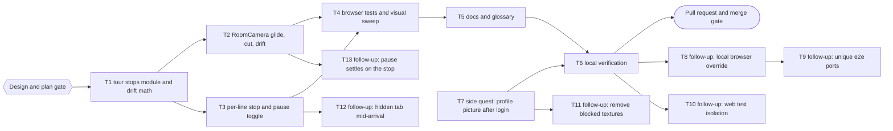
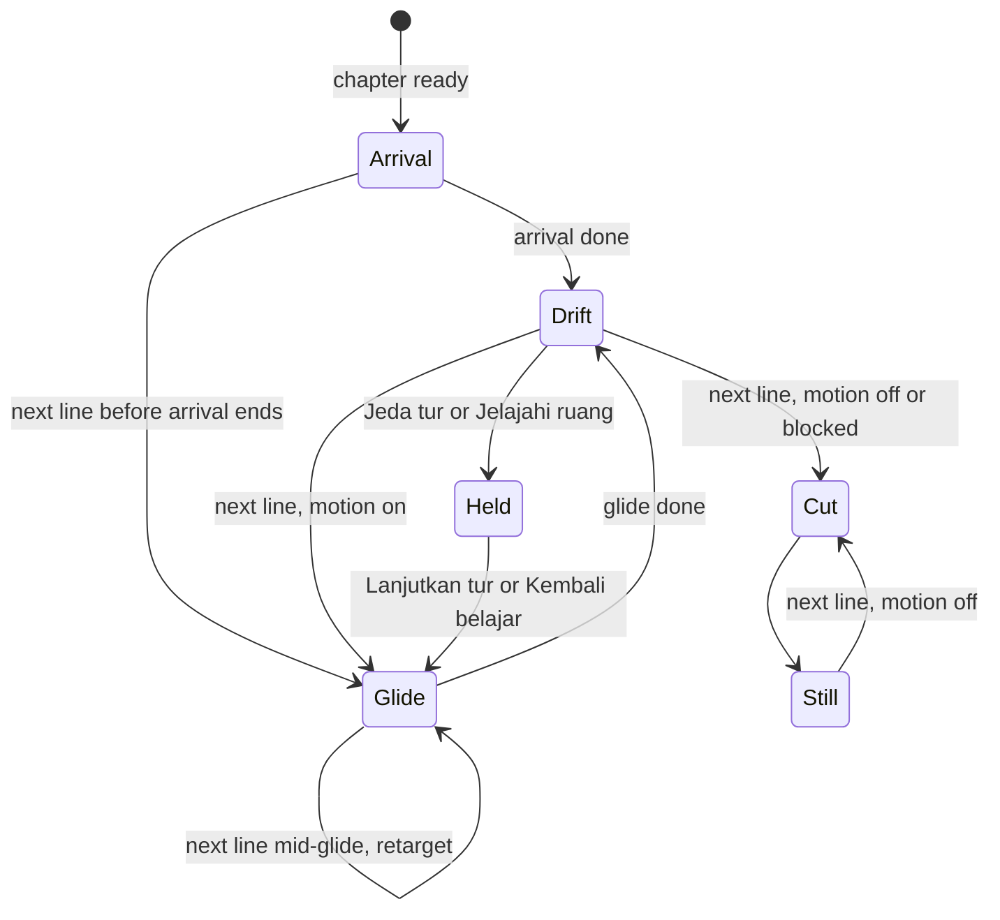

# Auto-Tour Implementation Plan

> For agentic workers: REQUIRED EXECUTION METHOD: delegated task execution (recommended) or inline plan execution. Steps use checkbox syntax.

**Goal:** Every dialogue line moves the 3D camera to the next corner of the matched room, so the visitor watches a continuous tour while pressing continue.

**Architecture:** A pure module builds an ordered list of tour stops per room and visit from views the project already verified (the visit cameras, the three object close-ups) plus orbits inside the manual look-around limits. `HistoricalEnvironment` maps `storyStep` to a stop and owns the pause state. `RoomCamera` glides to the stop (about 2.4 s), drifts slowly while the line is read, cuts instantly when motion is off, and retargets from the current pose when the visitor clicks faster than the glide.

**Tech Stack:** Bun 1.4.2 workspaces, React 18, `@react-three/fiber` 8.18.0, three 0.170.0, `bun:test` with happy-dom, Playwright 1.63.0 (Chromium with SwiftShader).

**Active Project Profile:**
- Repository root: `/home/belajarcarabelajar/Proyek/time-capsule`; session worktree `/home/belajarcarabelajar/Proyek/time-capsule-wt/auto-tour`, branch `2026-10-21-auto-tour/auto-tour`, base `origin/main` at `38ded6e`.
- Target scope: `apps/web/src/immersive`, `apps/web/e2e`, docs.
- Configuration sources: root `package.json` (`test:quality`), `apps/web/package.json` (`test`, `lint`, `test:immersive`), `apps/web/playwright.*.config.js`, `docs/history-environments.md`.
- CI is disabled by the owner (2026-10-21); verification is local only.

**Project Commands:**
- Targeted unit tests: `cd apps/web && bun test src/immersive/__tests__/<file>`.
- Lint: `bun run --cwd apps/web lint`.
- Browser: `cd apps/web && bunx playwright test --config <config>`; check `free -m` and leftover `chromium` processes first (A12).
- Quality gate: `bun run test:quality`, `bun run build`, `bun run test:client-assets`.

**Protected Boundaries:**
- `roomAssets.test.js` asserts that `resolveVisit(id, 1..3).camera` equals the views in each `export-report.json`; visit cameras and `visualVisits.js` stay unchanged.
- Dialogue, quiz, narrator, points, auth, and AI contracts stay unchanged. The camera never delays a line.
- Click and Enter on the controls never advance the lesson (existing `stopPropagation` contract).

**Scope:** (side quest T7, added by the owner on 2026-10-21 for the same PR) the profile picture after login; tour stops module and drift math; camera glide, cut, drift, and retarget; per-line stop selection, pause toggle and its storage; browser tests with a visual sweep of every stop in all 8 rooms; docs and glossary.

**Non-Goals:** AI-chosen camera shots per line (needs a schema change); new hand-placed waypoints; a tour in poster (static) mode; changing arrival shots or chapter visits; moving through walls or walking inside rooms.

**Visual Map:**



**Runtime flow:**



**Reasoning Lenses:** intent (owner's request plus four answered decisions); investigative (`RoomCamera.jsx` ignores `storyStep`, open diorama geometry, verified views and `yawLimit`); computational (stop ordering, orbit math, drift bounds); user-centered and accessibility (WCAG 2.2.2 pause control, reduced motion cut); systems (arrival, blocked, explore, inspect interplay); test-first; verification with screenshots.

**Approvals:**
- Design gate (Bounded, also Gate 2 for this validated plan): Approved by the owner on 2026-10-21 through the question tool.

**Owner decisions (2026-10-21, answered through the question tool):**
- Tour stops: verified views plus orbits (no new coordinates).
- Motion: glide plus slow drift.
- Motion off (reduced motion or `Jeda gerakan`): instant cut per line.
- Pause: a `Jeda tur` toggle on the gameplay bar.

**Acceptance Criteria:**
- AC1: `buildTour(room, visit)` returns 8 stops for every room and visit; stop 0 equals `visit.camera`; no two consecutive stops (including the wrap) are equal; no two consecutive stops are both object close-ups.
- AC2: every orbit stop is the base view rotated around its target by offsets inside `clampView(..., room.camera)` limits, at most 0.8 of `yawLimit` and `pitchLimit`; all coordinates are finite.
- AC3: `tourStopAt(tour, step)` cycles with the step; a negative, non-integer, or non-finite step returns stop 0.
- AC4: `driftPose(stop, 0, limits)` equals the stop; for any elapsed time the added yaw stays at or below `min(0.05, 0.12 * yawLimit)`, the distance to the target changes by at most 1.5%, and the target never moves.
- AC5: `chooseCameraTransition` returns `arrival` for a pending arrival with motion, `glide` with `TOUR_GLIDE_SECONDS` for a tour stop change with motion, `glide` with 0.45 s for explore or inspect changes with motion, `cut` when motion is off, and `cut` when an arrival ends without a view change (skip button).
- AC6: in gameplay, each `storyStep` change passes the matching stop to the renderer as `tourStop`; the root carries `data-tour-stop` with the stop id and `data-tour` `on` or `paused`.
- AC7: `Jeda tur` holds the current stop and turns drift off; further lines do not change the stop; `Lanjutkan tur` jumps to the stop of the current line; the choice persists in `sessionStorage` key `history-tour`; a new chapter starts at stop 0.
- AC8: the toggle is hidden on the start screen, in poster mode, after a renderer failure, and while blocked; clicking it or pressing Enter on it does not advance the lesson.
- AC9: with reduced motion the stop still changes per line and the canvas shows a different view per line (instant cut); with motion on a glide is visible mid-way and settles on the stop.
- AC10: the arrival, skip, explore, inspect, Escape, reduced-motion, and blocked behaviors covered by existing tests stay green.
- AC11: screenshots of every stop in all 8 rooms (64 settled frames plus mid-glide frames) are reviewed and show no camera inside geometry and no empty background; findings go to the evidence file.

**Traceability:**

| AC | Task | Check | Evidence |
|---|---|---|---|
| AC1 to AC5 | T1 | `tourStops.test.js`, `cameraMotion.test.js` | exit codes |
| AC5 | T2 | wired in `RoomCamera.jsx`; browser checks in T4 | exit codes |
| AC6 to AC8 | T3 | `AutoTour.test.jsx` | exit code |
| AC9, AC11 | T4 | `auto-tour.spec.js`, contact sheets | exit 0; 64 settled and 64 mid-glide (GPU) frames reviewed; drift extremes not rendered (`visual-sweep.md`) |
| AC10 | T2, T3, T6 | existing unit and browser suites | exit codes |

**Assumptions & Open Questions:**
- Assumption: narrator, quiz, continue prompt, and loading lines stay `blocked`; the stop still follows `storyStep`, so the camera cuts behind the 80% black overlay and the next visible line glides from there.
- Assumption: `Jelajahi ruang` starts from the current tour stop and holds the tour; `Kembali belajar` glides back to the current line's stop.
- Assumption: glide length is a constant 2.4 s; a click mid-glide retargets from the current pose with no queue.
- Assumption: linear glides between a far shot and a close-up stay outside geometry because close-ups are never consecutive; T4 screenshots verify it.
- Open: none blocking.

**Dependencies & Impact:** no new dependency. `RoomCanvas` and `RoomCamera` gain props `tourStop` and `drift`; their only caller is `HistoricalEnvironment`. `mockHistoryApi` gains an optional fourth argument; existing callers are unchanged.

**Risks & Rollback:**
- Risk: motion discomfort; mitigated by reduced-motion cuts, `Jeda gerakan`, and `Jeda tur`.
- Risk: a glide path crosses a prop in one room; T4 screenshots catch it, and the fix is reordering that room's stops.
- Rollback: revert the merge commit and redeploy Pages.

**Security & Compatibility:** no data, network, or storage change beyond one `sessionStorage` key; storage failures are ignored like `history-render-mode`.

**Operations & Rollout:** after merge, Pages deploy from `main` behind its own approval (`scripts/deploy-website.sh`).

**CI/Review Gate:** CI disabled; local T6 log plus an independent reviewer report with no open P0 or P1.

**Documentation:** `GLOSSARY.md` (tour stop, auto-tour, drift), `docs/history-environments.md` camera paragraph, README browser test command.

**Definition of Done:** T1 to T6 green in this session with exit codes, screenshots reviewed, PR open and registered.

**Plan Status & Version:** InProgress (kept open by the owner at the debt sweep; follow-ups T8 to T13 done), version 1.

**Follow-up backlog (for the Step 6 debt sweep):**
- F1: no Playwright-bundled browser on this machine; every `playwright.*.config.js` fails at launch locally. Options: `bunx playwright install chromium`, or an env-gated `executablePath` in the configs.
- F2 (same class as T7): two remote background textures from `https://www.transparenttextures.com` are blocked by the same `img-src` (`apps/web/src/components/StartScreen.jsx:36`, legacy non-immersive mode; `packages/ui/src/components/DynamicBackground.jsx:65`). Options: bundle locally, allow the host, or remove.
- F3 (2026-10-21, `2026-10-21-auto-tour-backlog` T5: environment limit, documented in README; Playwright's Ubuntu WebKit build needs ICU 74, `libxml2.so.2`, flite, absent on Arch): the immersive config's WebKit project cannot run on this machine (no WebKit build); only Chromium is verified.
- F4: under SwiftShader (the repo configs' `--use-angle=swiftshader`) with motion on, the frame monitor switches to the poster within seconds (53 of 64 mid-glide frames); the laptop GPU (`--use-angle=gl-egl`) renders all 64. Option: an env-gated GPU flag set in `playwright.tour.config.js`.
- F6: 10 web tests (7 `AuthContext & AuthProvider`, 3 balance refresh) fail in the full `bun run --cwd apps/web test` run on `main` and on this branch alike, and pass in isolation; cross-file isolation problem, pre-existing (evidence in `verification.md`).
- F7: `playwright.profile.config.js` first shared port 5175 with `playwright.journeys.config.js`; moved to 5177 in `016928e`.
- F8 (pre-existing, review 1): hiding the tab mid-arrival can leave `data-journey="arrival"` and the skip button until the next line (code reading, unconfirmed).
- F9 (closed by `2026-10-21-auto-tour-backlog` T4, `bcf5b5c`; pre-existing, review 1): keyboard look offsets returning to zero cut instead of the 0.45 s exit glide.
- F10 (closed by `2026-10-21-auto-tour-backlog` T1, `a00ba49`; re-pass after T10): `useGameState.test.jsx` still mocks `../utils/history`, a path that does not exist from `src/hooks/__tests__`, so the mock is dead and the hook tests run the real `generateHistorySummary`. defer: harmless today (history tests pass), repoint or delete when that file is next edited.
- F11 (closed by `2026-10-21-auto-tour-backlog` T3 with a runtime test, `bcf5b5c`; re-pass after T13): the pause settle glide is unit-tested only (`shouldSettle`); no browser frame proves it. defer: visual only, add a GPU frame check when the tour spec is next extended.
- F5: `Jeda tur` freezes the camera at the current drift offset (up to 0.05 rad, 1.5% dolly) rather than settling on the stop.

**Reproducibility:** Bun lockfile; browser tests use the mocked scenario fixture and reduced motion for settled frames.

**Test Reliability:** unit tests use pure functions and the existing renderer harness; browser tests wait on `data-tour-stop` and two animation frames, not on fixed sleeps, except the mid-glide frame, which is evidence only and not asserted.

**Privacy & Data Governance:** N/A (no personal data).

**Dependencies & Supply Chain:** N/A (no new package).

**UX States:** toggle labels `Jeda tur` and `Lanjutkan tur` with icons, icon-only on 600 px and below with the label as `aria-label`.

**Persistent State & Artifact Storage:** `sessionStorage` `history-tour` (`paused` or absent).

**Entity & Sourcing Verification:** WCAG 2.2 success criterion 2.2.2 Pause, Stop, Hide (moving content that starts automatically and lasts over 5 seconds needs a pause mechanism).

**Verification:** T6 run log and screenshots in `docs/code-plan/evidence/2026-10-21-auto-tour/`.

### Task T8: local browser override (follow-up)

Selected by the owner in the debt sweep (2026-10-21). A pure helper `apps/web/playwright.launch.js` builds Chromium launch options from the environment: `PLAYWRIGHT_CHROMIUM=<path>` sets `executablePath`; `PLAYWRIGHT_GPU=1` swaps the SwiftShader flags for `--ignore-gpu-blocklist --use-gl=angle --use-angle=gl-egl`; with neither set the options equal today's literal. The four configs that set `launchOptions` use it (journeys and enrichment inherit from immersive). README documents both variables. On this laptop, readiness and the runner run with `PLAYWRIGHT_CHROMIUM=/usr/bin/chromium`.

- [x] Step 1: RED helper tests in `build-website.test.js` | expect: exit 1
- [x] Step 2: helper, configs, README | `bun run test:script` exit 0; profile and tour configs exit 0 with the env
- [x] Step 3: Commit (parent) by path.
- Evidence: `9963229`; `bun run test:script` exit 0 (17 pass); with `PLAYWRIGHT_CHROMIUM=/usr/bin/chromium`: profile exit 0 (2), tour exit 0 (3 passed, 1 skipped), tour with `PLAYWRIGHT_GPU=1` exit 0, immersive `--project chromium` exit 0 (11); without the variable the profile config still fails at launch as before.

### Task T9: unique e2e ports (follow-up)

A `build-website.test.js` case "every Playwright config uses its own dev server port" reads `apps/web/playwright.*.config.js` and fails on a duplicate (memory rule M5).

- [x] Step 1: test, red on a temporary duplicate, green on the real configs
- [x] Step 2: Commit (parent) by path.
- Evidence: `9963229`; the new port test was red on the real configs (immersive and fallback both on 5173), fallback moved to 5178 (fallback exit 0, 1 passed on 5178); `bun run test:script` exit 0.

### Task T10: web test isolation (follow-up)

Root-cause and fix the 10 tests that fail only in the full `bun run --cwd apps/web test` run (F6), in test code unless the cause is in production code.

- [x] Step 1: red-capable loop shown (the full run, exit 1, 10 fail), ranked hypotheses
- [x] Step 2: fix at the shared cause | `cd apps/web && bun run test` exit 0
- [x] Step 3: Commit (parent) by path.
- Evidence: `86a4c42`. Root cause: `mock.module('../../context/AuthContext')` in `useGameState.test.jsx` replaced the module for the whole bun process (`mock.restore()` does not undo it); pairing bisect: only that file plus the context tests reproduced the 10 failures. Fix: a spy restored in `afterEach`, plus a test that the real module is back. `bun run test` in `apps/web` exit 0 (299 pass, 0 fail; RoomModel 2 pass).

### Task T11: remove blocked remote textures (follow-up)

Remove the two `https://www.transparenttextures.com` backgrounds (`StartScreen.jsx:36`, `packages/ui/src/components/DynamicBackground.jsx:65`); production CSP blocks them today, so nothing visible changes. Regression test "renders no remote texture".

- [x] Step 1: RED test | expect: exit 1
- [x] Step 2: remove both URLs | StartScreen and ui tests exit 0
- [x] Step 3: Commit (parent) by path.
- Evidence: `78b9544`; RED exit 1 in both files on the texture elements; StartScreen tests exit 0 (4), ui package tests exit 0 (58); `rg transparenttextures apps packages` exit 1.

### Task T12: hidden tab mid-arrival (follow-up)

Reproduce the reviewer's suspicion (F8) with a harness test; fix only if it goes red, otherwise keep the green test as proof.

- [x] Step 1: harness test | result recorded
- [x] Step 2: fix if red | `AutoTour.test.jsx` and `VisualJourney.test.jsx` exit 0
- [x] Step 3: Commit (parent) by path.
- Evidence: `fe9c325`; suspicion confirmed: RED exit 1 (`arriving` true after the tab returned); fix adds `!visible` to the cancel condition; `AutoTour.test.jsx` exit 0 (17), control test (hidden while blocked only defers) green before and after.

### Task T13: pause settles on the stop (follow-up)

`Jeda tur` glides 0.45 s onto the exact stop instead of freezing at the drift offset (F5), through a new `chooseCameraTransition` row.

- [x] Step 1: RED transition test | expect: exit 1
- [x] Step 2: table row and `RoomCamera.jsx` wiring | `cameraMotion.test.js` exit 0, eslint exit 0
- [x] Step 3: Commit (parent) by path.
- Evidence: `4b46d50`; RED exit 1 (`shouldSettle` export missing); `cameraMotion.test.js` exit 0 (25); `bun test src/immersive` exit 0 (224); eslint exit 0. Not browser-tested (no r3f harness).

## Closeout status

- Owner answer at the debt sweep (2026-10-21): **Keep it open**; follow-ups T8 to T13 selected and done.
- Readiness after the follow-ups and the merge of `main` (`PLAYWRIGHT_CHROMIUM=/usr/bin/chromium bun ~/vivera/scripts/plan-closeout.mjs --readiness`, exit 3): **NEEDS-HUMAN**. T1 to T5 and T7 to T13 DONE; T6 UNPROVEN because its `skip_if` is `false` (the full local gate has no single re-runnable proof). Its evidence is the final run on the merged tree in `docs/code-plan/evidence/2026-10-21-auto-tour/verification.md`, every step exit 0. Open step boxes 0.
- What remains: the owner's merge decision for PR #47 and the plan status decision; the graphify sync, which must run in the main checkout after the merge (`graphify update .` then `bun ~/vivera/scripts/graphify-sync.mjs --root "$(pwd)"`, then `--check`), because the graph there reflects `main`.
- Reopen trigger: the owner merges PR #47; then re-run readiness on `main` and decide `Complete`.

## Global Constraints

- `TOUR_GLIDE_SECONDS` 2.4; explore and inspect transitions keep 0.45 s.
- Drift period 16 s, yaw amplitude `min(0.05, 0.12 * yawLimit)`, dolly at most 1.5%.
- Orbit offsets at most 0.8 of `yawLimit` and `pitchLimit`.
- No em dash in any diff line or commit message; no attribution trailer.

## Shared Contract

```js
// apps/web/src/immersive/tourStops.js
export const TOUR_GLIDE_SECONDS; // 2.4
export function buildTour(room, visit); // -> Array<{ id: string, kind: 'wide'|'orbit'|'close', position: [x, y, z], target: [x, y, z] }>, length 8, [0] pose equals visit.camera
export function tourStopAt(tour, step); // -> tour[step mod length]; invalid step -> tour[0]

// apps/web/src/immersive/cameraMotion.js (added)
export function driftPose(stop, elapsed, limits); // -> { position, target }
export function chooseCameraTransition({ initialized, motionEnabled, arriving, arrivalPending, wasArrival, viewChanged, tourAdvance }); // -> { kind: 'arrival'|'glide'|'cut', duration }
```

Base stop order per room (rotated so the tour starts at the stop whose pose equals `visit.camera`): `wide` (`room.camera`), `sweep-left` (wide orbited by `-0.8 * yawLimit`), `close` object 0, `detail` (`resolveVisit(room.id, 2).camera`), `close` object 1, `sweep-right` (wide orbited by `+0.8 * yawLimit`), `close` object 2, `overview` (detail orbited by `-0.8 * pitchLimit`). Ids are `<roomId>:<name>`, for example `archive:sweep-left`, `archive:close-map`.

Renderer props added: `tourStop` (a stop or `null`) and `drift` (boolean). `RoomCamera` view precedence: `selectedObject.view`, then `tourStop`, then `visit.camera`, then `room.camera`.

### Task T1: tour stops module and drift math

**Files:**
- Create: `apps/web/src/immersive/tourStops.js`, `apps/web/src/immersive/__tests__/tourStops.test.js`
- Modify: `apps/web/src/immersive/cameraMotion.js`
- Test: `apps/web/src/immersive/__tests__/cameraMotion.test.js`

**Interfaces:** consumes `roomManifest`, `resolveVisit`, `clampView`, three `Vector3` and `Spherical`; produces the Shared Contract.

**Preconditions:**
- [x] `ls apps/web/node_modules/.bin/eslint` or the hoisted root copy exists (else `E_PRECOND_DEP`).

**Idempotency Check:**
- [x] Skip when `skip_if` exits 0.

**Behavior & Acceptance:** AC1 to AC5. Orbit math matches `RoomCamera.applyView` (spherical theta plus yaw, phi plus pitch, `makeSafe`).

**Edge Cases & Failure Behavior:** unknown room id falls back like `resolveVisit`; a visit camera not found in the base list is prepended; step `-1`, `1.5`, `NaN`, `Infinity`.

**Deliberate Shortcuts & Deferrals:** None.

**Dependencies & Risks:** none upstream.

**Review & Evidence:** test exit codes.

**Reasoning Output:** pure functions so the camera and state tasks share one tested source.

**Test Data & Determinism:** the real `roomManifest`, no randomness.

- [x] Step 1: Write failing tests in `tourStops.test.js` and new cases in `cameraMotion.test.js`.
- [x] Step 2: Run: verify fail | cmd: `cd apps/web && bun test src/immersive/__tests__/tourStops.test.js` | expect: exit 1 | retry: 0 | on_fail: n/a
- [x] Step 3: Implement `tourStops.js` and the two `cameraMotion.js` exports.
- [x] Step 4: Run: verify pass | cmd: `cd apps/web && bun test src/immersive/__tests__/tourStops.test.js` | expect: exit 0 | retry: 1 | on_fail: mark FAILED, halt T2 to T6
- [x] Step 5: Run: `cd apps/web && bun test src/immersive/__tests__/cameraMotion.test.js` | expect: exit 0
- [x] Step 6: Commit (parent): stage the four files by path. Evidence: RED `tourStops.test.js` exit 1 (module missing, then 50 assertion failures on a stub; mutation `theta -=` gave 10 failures); GREEN `bun test src/immersive` exit 0, 200 pass; eslint exit 0; commit `c722f52`.

### Task T2: RoomCamera glide, cut, drift

**Files:**
- Modify: `apps/web/src/immersive/RoomCamera.jsx`, `apps/web/src/immersive/RoomCanvas.jsx`

**Interfaces:** consumes `chooseCameraTransition`, `driftPose`, `TOUR_GLIDE_SECONDS`; accepts `tourStop` and `drift`.

**Behavior & Acceptance:** AC5, AC10. The view effect calls `chooseCameraTransition`; glides start from the current camera pose; drift runs in `useFrame` only when `drift`, motion on, not exploring, no selected object, and no active motion; drift time resets on every transition or cut.

**Edge Cases & Failure Behavior:** click mid-glide (retarget), arrival interrupted by a line (glide, not cut), skip button (cut), explore exit (0.45 s glide back to the stop), motion toggled mid-drift.

**Deliberate Shortcuts & Deferrals:** no unit test for the r3f component (no `@react-three/test-renderer` in the repo); the decision logic is unit-tested in T1 and the behavior in T4.

**Review & Evidence:** lint and immersive unit suite exit codes; T4 browser evidence.

- [x] Step 1: Implement the props, view precedence, transition choice, and drift.
- [x] Step 2: Run: `cd apps/web && bunx eslint src/immersive/RoomCamera.jsx src/immersive/RoomCanvas.jsx` | expect: exit 0
- [x] Step 3: Run: `cd apps/web && bun test src/immersive` | expect: exit 0
- [x] Step 4: Commit (parent): stage both files by path. Evidence: eslint exit 0; `bun test src/immersive` excluding T3's in-progress `AutoTour.test.jsx` exit 0, 200 pass; full suite rerun after T3 lands in T3 Step 5.

### Task T3: per-line stop and pause toggle

**Files:**
- Create: `apps/web/src/immersive/__tests__/AutoTour.test.jsx`
- Modify: `apps/web/src/immersive/HistoricalEnvironment.jsx`, `apps/web/src/immersive/EnvironmentControls.jsx`

**Interfaces:** consumes `buildTour`, `tourStopAt`; produces the `tourStop` and `drift` renderer props, `data-tour-stop`, `data-tour`, and the toggle.

**Behavior & Acceptance:** AC6 to AC8, AC10. The toggle sits in `.history-controls__bar` after the mode button, follows the mode button idiom (changing `aria-label`, icon plus label span), icons `⏸️` and `▶️`.

**Edge Cases & Failure Behavior:** pause then a new chapter (stop 0), pause while exploring, storage throws, start screen (no tour, `tourStop` `null`).

**Test Data & Determinism:** the existing `harness()` renderer pattern from `VisualJourney.test.jsx`.

- [x] Step 1: Write failing tests in `AutoTour.test.jsx`.
- [x] Step 2: Run: verify fail | cmd: `cd apps/web && bun test src/immersive/__tests__/AutoTour.test.jsx` | expect: exit 1 | retry: 0 | on_fail: n/a
- [x] Step 3: Implement the state, props, attributes, and toggle.
- [x] Step 4: Run: verify pass | cmd: `cd apps/web && bun test src/immersive/__tests__/AutoTour.test.jsx` | expect: exit 0 | retry: 1 | on_fail: mark FAILED, halt T4 to T6
- [x] Step 5: Run: `cd apps/web && bun test src/immersive/__tests__/VisualJourney.test.jsx src/immersive/__tests__/HistoricalEnvironment.test.jsx` | expect: exit 0
- [x] Step 6: Commit (parent): stage the three files by path. Evidence: RED `AutoTour.test.jsx` exit 1 (11 fail on missing prop, attribute, button; arrival-lag case 1 fail); GREEN exit 0, 14 pass; six mutations each turned the expected test red; parent rerun `bun test src/immersive` exit 0, 214 pass; eslint exit 0; `App.test.jsx` exit 0.

### Task T4: browser tests and visual sweep

**Files:**
- Create: `apps/web/e2e/auto-tour.spec.js`, `apps/web/playwright.tour.config.js`
- Modify: `apps/web/e2e/fixtures/historyScenarios.js` (a `tourScenario` with 9 dialogue lines; optional fourth `mockHistoryApi` argument), `apps/web/package.json` (`test:tour`)

**Behavior & Acceptance:** AC9, AC11. Chromium desktop: per line, `data-tour-stop` follows the stop order and the canvas pixels differ from the previous line (reduced motion); pause holds the stop across two lines and resume jumps; with motion on, a mid-glide frame differs from both ends. With `TOUR_SHOTS=<dir>`, the spec saves every settled and mid-glide frame for all 8 rooms; the parent builds contact sheets with `montage` and reviews them.

**Preconditions:**
- [x] `free -m` shows at least 2 GB available and no leftover `chromium` process (A12), else stop and report.

- [x] Step 1: Write the spec, config, fixture, and script in the same wave as T1 (disjoint files), against the Shared Contract, before any production code exists.
- [x] Step 2: RED: run `cd apps/web && bunx playwright test --config playwright.tour.config.js` on the base code | expect: exit 1 for the missing `data-tour-stop` and toggle, not for a setup error.
- [x] Step 3: Run: `cd apps/web && bunx playwright test --config playwright.tour.config.js` | expect: exit 0 | retry: 1
- Evidence so far: this machine has no Playwright-bundled browsers (`~/.cache/ms-playwright` is missing), so every repo config fails at launch; runs use scratch wrapper configs that only add `executablePath: '/usr/bin/chromium'` (Chromium 154). RED on the base code: exit 1, three tests failed on `data-tour-stop` (`null` / `""`), sweep skipped. GREEN after T2 and T3: exit 0, 3 passed, 1 skipped (37.7 s). Available memory before runs 2.4 to 3.1 GB; no Chromium left afterwards.
- [x] Step 4: Run with `TOUR_SHOTS=$HOME/.cache/tmp/time-capsule-scratch/tour-shots`, build contact sheets into the evidence folder, review every frame, record findings.
- [x] Step 5: Commit (parent): stage the four files and the evidence by path.
- Evidence: spec, config, fixture, script committed as `22fa535`; sweep exit 0, 1 passed (5.6 min); 64 of 64 settled frames reviewed, no camera inside geometry; 11 of 64 mid-glide frames rendered in 3D, the rest fell back to the poster under SwiftShader (F4). Details: `docs/code-plan/evidence/2026-10-21-auto-tour/visual-sweep.md`.

### Task T5: docs and glossary

- [x] Step 1: `GLOSSARY.md` terms (first edit after the Design gate), `docs/history-environments.md` camera paragraph, README `test:tour` line.
- [x] Step 2: Run: `bun $HOME/vivera/scripts/check-copy-rules.mjs --diff origin/main` | expect: exit 0
- [x] Step 3: Commit (parent) by path.
- Evidence: `GLOSSARY.md` committed with the plan (`495f3d2`); docs, README, and the `test:tour`/`test:profile` scripts in `e65ef6e`; `check-copy-rules.mjs --diff origin/main` exit 0 (merge-base `38ded6e` = `origin/main`).

### Task T7: side quest, profile picture after login

Owner request (2026-10-21): the profile picture does not show after login; same PR, no separate PR.

**Evidence so far (read-only):**
- `apps/web/public/_headers` sets `img-src 'self' data: blob:` since `3e79c85` (2026-08-22); production `https://time-capsule.belajarcarabelajar.com/` serves the same header (curl, 2026-10-21).
- `functions/api/auth/callback.js` signs `picture: userData.picture` (a Google `https://lh3.googleusercontent.com/...` URL) into the JWT, and `functions/api/auth/me.js` returns it; `UserBar.jsx` renders `` with no error fallback.
- Hypothesis H1 (leading): the CSP blocks the cross-origin avatar. Prediction: applying the real `img-src` to the page makes the avatar fail to load; adding `https://lh3.googleusercontent.com` makes it load.
- Hypothesis H2: without `onError`, any avatar failure shows a broken image instead of the initial. Prediction: a 404 avatar shows no initial today.

**Fix shape:** add exactly `https://lh3.googleusercontent.com` to `img-src` (the build test forbids a broad `https:`), and fall back to the initial when the image errors.

**Files:** modify `apps/web/public/_headers`, `apps/web/src/components/UserBar.jsx`, `scripts/build-website.test.js`; test `apps/web/src/components/__tests__/UserBar.test.jsx`; create `apps/web/e2e/profile-avatar.spec.js`, `apps/web/playwright.profile.config.js`.

- [x] Step 1: RED unit: `UserBar.test.jsx` case "a profile picture that fails to load falls back to the initial" | cmd: `cd apps/web && bun test src/components/__tests__/UserBar.test.jsx` | expect: exit 1
- [x] Step 2: RED config: `build-website.test.js` case "Pages CSP allows the Google profile picture host and nothing broader" | cmd: `bun run test:script` | expect: exit 1
- [x] Step 3: browser spec applies the `img-src` parsed from `_headers` to the dev document, mocks `/api/auth/me` with a `https://lh3.googleusercontent.com/a/...` picture routed to a local PNG, and asserts the avatar loads (`naturalWidth > 0`); a second case routes the picture to 404 and expects the initial.
- [x] Step 4: implement the `_headers` and `UserBar.jsx` changes; both unit commands exit 0.
- [x] Step 5: browser RED by mutation (parent): restore the `origin/main` `_headers` line, prove the diff against the pristine file, run `cd apps/web && bunx playwright test --config playwright.profile.config.js` | expect: exit 1; restore the fix and rerun | expect: exit 0.
- [x] Step 6: Commit (parent) by path.
- Evidence: unit RED exit 1 (img still present after `error`), config RED exit 1 (`img-src` lacked the host); GREEN `UserBar.test.jsx` exit 0, 13 pass; `bun run test:script` exit 0, 14 pass; eslint exit 0. Browser (system Chromium wrapper): with the `origin/main` `_headers` (diff against `git show origin/main:` identical) exit 1, "loads after login" failed `Expected: true, Received: false`, fallback case passed; with the fix exit 0, 2 passed. H1 and H2 confirmed. Commit `e1a383c`.
- Superseded on 2026-10-21: the owner chose PR #48 (merged as `c56f00b`) to carry the profile picture fix (`img-src` allows `https://*.googleusercontent.com`; `UserBar` renders with `referrerPolicy="no-referrer"` and an initial fallback). Merge `513ce33` takes main's `_headers`, `UserBar.jsx`, and `UserBar.test.jsx` unchanged and drops this branch's exact-lh3 CSP test. This branch keeps `apps/web/e2e/profile-avatar.spec.js` and `playwright.profile.config.js` as browser proof; with `PLAYWRIGHT_CHROMIUM=/usr/bin/chromium` it passes against the merged behavior (exit 0, 2 passed) without changes.

### Task T6: local verification

- [x] Step 1: `free -m` and `ps -eo pid,cmd | rg chromium | rg -v ' rg '` before the browser suite (A12).
- [x] Step 2: run the `run[]` commands in order and record each exit code in `docs/code-plan/evidence/2026-10-21-auto-tour/verification.md`.
- Evidence (`docs/code-plan/evidence/2026-10-21-auto-tour/verification.md`): `bun run test:quality` exit 1 only on the 10 web tests that fail identically on `main` (F6); its later steps run separately: `test:backend` exit 0 (97), `test:script` exit 0 (14), `test:assets` exit 0, web lint exit 0, `bun run build` exit 0, `test:client-assets` exit 0. Browser (system Chromium wrappers, F1): tour exit 0, profile exit 0, immersive `--project chromium` exit 0 (11), enrichment desktop and 390 px exit 0 (18), journeys `--project chromium` exit 0 (4; WebKit cannot launch here, F3), fallback exit 0 (1); GPU rerun of the tour spec with the sweep exit 0 (4 passed, 64 of 64 mid-glide frames in 3D). Independent review 1: `correct`, findings resolved in `8c7f28f` (`review-1.md`).
- Decision 2026-10-31 (owner, batch closeout of merged plans): `Complete`. All registry sessions merged (`auto-tour`); previous status `InProgress`; task step boxes open: 0 of 52. `--readiness` was not run (owner's batch decision).
