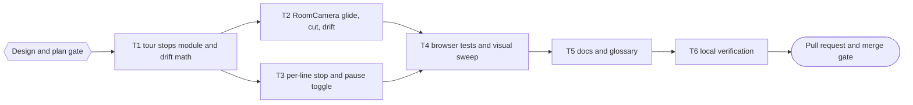
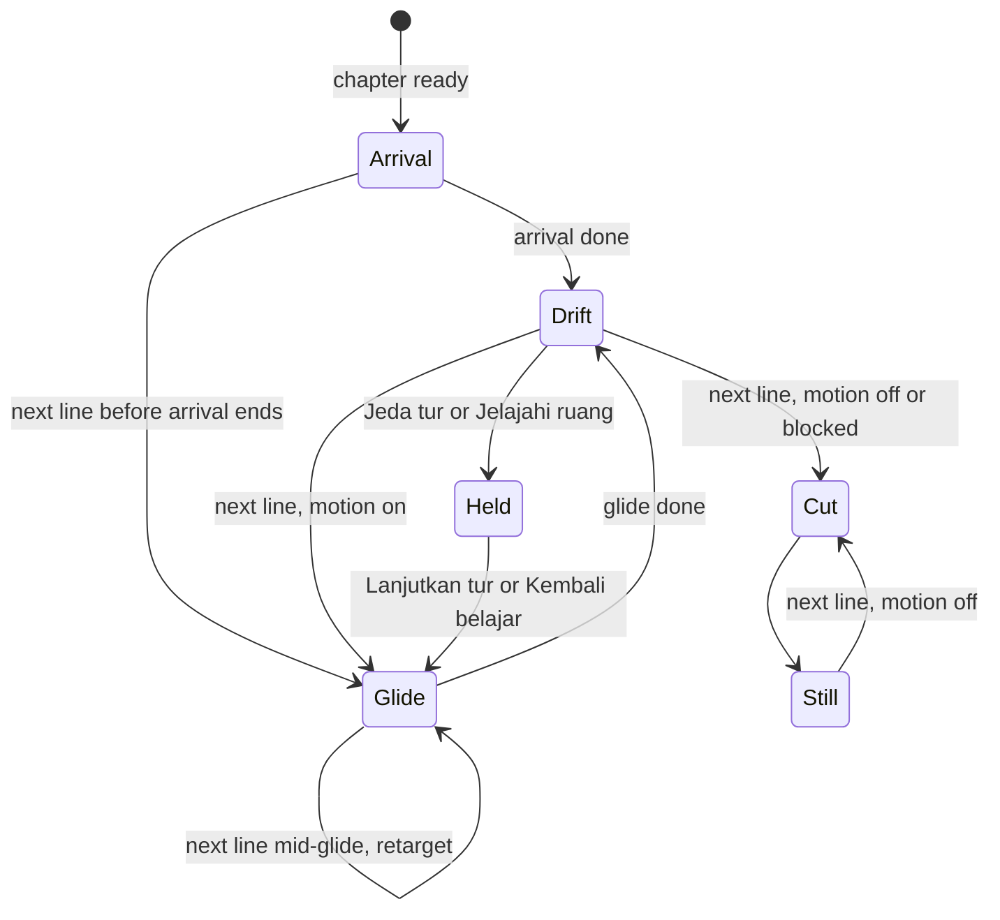

# Auto-Tour Implementation Plan

> For agentic workers: REQUIRED EXECUTION METHOD: delegated task execution (recommended) or inline plan execution. Steps use checkbox syntax.

**Goal:** Every dialogue line moves the 3D camera to the next corner of the matched room, so the visitor watches a continuous tour while pressing continue.

**Architecture:** A pure module builds an ordered list of tour stops per room and visit from views the project already verified (the visit cameras, the three object close-ups) plus orbits inside the manual look-around limits. `HistoricalEnvironment` maps `storyStep` to a stop and owns the pause state. `RoomCamera` glides to the stop (about 2.4 s), drifts slowly while the line is read, cuts instantly when motion is off, and retargets from the current pose when the visitor clicks faster than the glide.

**Tech Stack:** Bun 1.4.2 workspaces, React 18, `@react-three/fiber` 8.18.0, three 0.170.0, `bun:test` with happy-dom, Playwright 1.63.0 (Chromium with SwiftShader).

**Active Project Profile:**
- Repository root: `/home/belajarcarabelajar/Proyek/time-capsule`; session worktree `/home/belajarcarabelajar/Proyek/time-capsule-wt/auto-tour`, branch `2026-10-21-auto-tour/auto-tour`, base `origin/main` at `38ded6e`.
- Target scope: `apps/web/src/immersive`, `apps/web/e2e`, docs.
- Configuration sources: root `package.json` (`test:quality`), `apps/web/package.json` (`test`, `lint`, `test:immersive`), `apps/web/playwright.*.config.js`, `docs/history-environments.md`.
- CI is disabled by the owner (2026-10-21); verification is local only.

**Project Commands:**
- Targeted unit tests: `cd apps/web && bun test src/immersive/__tests__/<file>`.
- Lint: `bun run --cwd apps/web lint`.
- Browser: `cd apps/web && bunx playwright test --config <config>`; check `free -m` and leftover `chromium` processes first (A12).
- Quality gate: `bun run test:quality`, `bun run build`, `bun run test:client-assets`.

**Protected Boundaries:**
- `roomAssets.test.js` asserts that `resolveVisit(id, 1..3).camera` equals the views in each `export-report.json`; visit cameras and `visualVisits.js` stay unchanged.
- Dialogue, quiz, narrator, points, auth, and AI contracts stay unchanged. The camera never delays a line.
- Click and Enter on the controls never advance the lesson (existing `stopPropagation` contract).

**Scope:** tour stops module and drift math; camera glide, cut, drift, and retarget; per-line stop selection, pause toggle and its storage; browser tests with a visual sweep of every stop in all 8 rooms; docs and glossary.

**Non-Goals:** AI-chosen camera shots per line (needs a schema change); new hand-placed waypoints; a tour in poster (static) mode; changing arrival shots or chapter visits; moving through walls or walking inside rooms.

**Visual Map:**



**Runtime flow:**



**Reasoning Lenses:** intent (owner's request plus four answered decisions); investigative (`RoomCamera.jsx` ignores `storyStep`, open diorama geometry, verified views and `yawLimit`); computational (stop ordering, orbit math, drift bounds); user-centered and accessibility (WCAG 2.2.2 pause control, reduced motion cut); systems (arrival, blocked, explore, inspect interplay); test-first; verification with screenshots.

**Approvals:**
- Design gate (Bounded, also Gate 2 for this validated plan): Approved by the owner on 2026-10-21 through the question tool.

**Owner decisions (2026-10-21, answered through the question tool):**
- Tour stops: verified views plus orbits (no new coordinates).
- Motion: glide plus slow drift.
- Motion off (reduced motion or `Jeda gerakan`): instant cut per line.
- Pause: a `Jeda tur` toggle on the gameplay bar.

**Acceptance Criteria:**
- AC1: `buildTour(room, visit)` returns 8 stops for every room and visit; stop 0 equals `visit.camera`; no two consecutive stops (including the wrap) are equal; no two consecutive stops are both object close-ups.
- AC2: every orbit stop is the base view rotated around its target by offsets inside `clampView(..., room.camera)` limits, at most 0.8 of `yawLimit` and `pitchLimit`; all coordinates are finite.
- AC3: `tourStopAt(tour, step)` cycles with the step; a negative, non-integer, or non-finite step returns stop 0.
- AC4: `driftPose(stop, 0, limits)` equals the stop; for any elapsed time the added yaw stays at or below `min(0.05, 0.12 * yawLimit)`, the distance to the target changes by at most 1.5%, and the target never moves.
- AC5: `chooseCameraTransition` returns `arrival` for a pending arrival with motion, `glide` with `TOUR_GLIDE_SECONDS` for a tour stop change with motion, `glide` with 0.45 s for explore or inspect changes with motion, `cut` when motion is off, and `cut` when an arrival ends without a view change (skip button).
- AC6: in gameplay, each `storyStep` change passes the matching stop to the renderer as `tourStop`; the root carries `data-tour-stop` with the stop id and `data-tour` `on` or `paused`.
- AC7: `Jeda tur` holds the current stop and turns drift off; further lines do not change the stop; `Lanjutkan tur` jumps to the stop of the current line; the choice persists in `sessionStorage` key `history-tour`; a new chapter starts at stop 0.
- AC8: the toggle is hidden on the start screen, in poster mode, after a renderer failure, and while blocked; clicking it or pressing Enter on it does not advance the lesson.
- AC9: with reduced motion the stop still changes per line and the canvas shows a different view per line (instant cut); with motion on a glide is visible mid-way and settles on the stop.
- AC10: the arrival, skip, explore, inspect, Escape, reduced-motion, and blocked behaviors covered by existing tests stay green.
- AC11: screenshots of every stop in all 8 rooms (64 settled frames plus mid-glide frames) are reviewed and show no camera inside geometry and no empty background; findings go to the evidence file.

**Traceability:**

| AC | Task | Check | Evidence |
|---|---|---|---|
| AC1 to AC5 | T1 | `tourStops.test.js`, `cameraMotion.test.js` | exit codes |
| AC5 | T2 | wired in `RoomCamera.jsx`; browser checks in T4 | exit codes |
| AC6 to AC8 | T3 | `AutoTour.test.jsx` | exit code |
| AC9, AC11 | T4 | `auto-tour.spec.js`, contact sheets | exit code, `docs/code-plan/evidence/2026-10-21-auto-tour/` |
| AC10 | T2, T3, T6 | existing unit and browser suites | exit codes |

**Assumptions & Open Questions:**
- Assumption: narrator, quiz, continue prompt, and loading lines stay `blocked`; the stop still follows `storyStep`, so the camera cuts behind the 80% black overlay and the next visible line glides from there.
- Assumption: `Jelajahi ruang` starts from the current tour stop and holds the tour; `Kembali belajar` glides back to the current line's stop.
- Assumption: glide length is a constant 2.4 s; a click mid-glide retargets from the current pose with no queue.
- Assumption: linear glides between a far shot and a close-up stay outside geometry because close-ups are never consecutive; T4 screenshots verify it.
- Open: none blocking.

**Dependencies & Impact:** no new dependency. `RoomCanvas` and `RoomCamera` gain props `tourStop` and `drift`; their only caller is `HistoricalEnvironment`. `mockHistoryApi` gains an optional fourth argument; existing callers are unchanged.

**Risks & Rollback:**
- Risk: motion discomfort; mitigated by reduced-motion cuts, `Jeda gerakan`, and `Jeda tur`.
- Risk: a glide path crosses a prop in one room; T4 screenshots catch it, and the fix is reordering that room's stops.
- Rollback: revert the merge commit and redeploy Pages.

**Security & Compatibility:** no data, network, or storage change beyond one `sessionStorage` key; storage failures are ignored like `history-render-mode`.

**Operations & Rollout:** after merge, Pages deploy from `main` behind its own approval (`scripts/deploy-website.sh`).

**CI/Review Gate:** CI disabled; local T6 log plus an independent reviewer report with no open P0 or P1.

**Documentation:** `GLOSSARY.md` (tour stop, auto-tour, drift), `docs/history-environments.md` camera paragraph, README browser test command.

**Definition of Done:** T1 to T6 green in this session with exit codes, screenshots reviewed, PR open and registered.

**Plan Status & Version:** Approved, version 1.

**Reproducibility:** Bun lockfile; browser tests use the mocked scenario fixture and reduced motion for settled frames.

**Test Reliability:** unit tests use pure functions and the existing renderer harness; browser tests wait on `data-tour-stop` and two animation frames, not on fixed sleeps, except the mid-glide frame, which is evidence only and not asserted.

**Privacy & Data Governance:** N/A (no personal data).

**Dependencies & Supply Chain:** N/A (no new package).

**UX States:** toggle labels `Jeda tur` and `Lanjutkan tur` with icons, icon-only on 600 px and below with the label as `aria-label`.

**Persistent State & Artifact Storage:** `sessionStorage` `history-tour` (`paused` or absent).

**Entity & Sourcing Verification:** WCAG 2.2 success criterion 2.2.2 Pause, Stop, Hide (moving content that starts automatically and lasts over 5 seconds needs a pause mechanism).

**Verification:** T6 run log and screenshots in `docs/code-plan/evidence/2026-10-21-auto-tour/`.

## Global Constraints

- `TOUR_GLIDE_SECONDS` 2.4; explore and inspect transitions keep 0.45 s.
- Drift period 16 s, yaw amplitude `min(0.05, 0.12 * yawLimit)`, dolly at most 1.5%.
- Orbit offsets at most 0.8 of `yawLimit` and `pitchLimit`.
- No em dash in any diff line or commit message; no attribution trailer.

## Shared Contract

```js
// apps/web/src/immersive/tourStops.js
export const TOUR_GLIDE_SECONDS; // 2.4
export function buildTour(room, visit); // -> Array<{ id: string, kind: 'wide'|'orbit'|'close', position: [x, y, z], target: [x, y, z] }>, length 8, [0] pose equals visit.camera
export function tourStopAt(tour, step); // -> tour[step mod length]; invalid step -> tour[0]

// apps/web/src/immersive/cameraMotion.js (added)
export function driftPose(stop, elapsed, limits); // -> { position, target }
export function chooseCameraTransition({ initialized, motionEnabled, arriving, arrivalPending, wasArrival, viewChanged, tourAdvance }); // -> { kind: 'arrival'|'glide'|'cut', duration }
```

Base stop order per room (rotated so the tour starts at the stop whose pose equals `visit.camera`): `wide` (`room.camera`), `sweep-left` (wide orbited by `-0.8 * yawLimit`), `close` object 0, `detail` (`resolveVisit(room.id, 2).camera`), `close` object 1, `sweep-right` (wide orbited by `+0.8 * yawLimit`), `close` object 2, `overview` (detail orbited by `-0.8 * pitchLimit`). Ids are `<roomId>:<name>`, for example `archive:sweep-left`, `archive:close-map`.

Renderer props added: `tourStop` (a stop or `null`) and `drift` (boolean). `RoomCamera` view precedence: `selectedObject.view`, then `tourStop`, then `visit.camera`, then `room.camera`.

### Task T1: tour stops module and drift math

**Files:**
- Create: `apps/web/src/immersive/tourStops.js`, `apps/web/src/immersive/__tests__/tourStops.test.js`
- Modify: `apps/web/src/immersive/cameraMotion.js`
- Test: `apps/web/src/immersive/__tests__/cameraMotion.test.js`

**Interfaces:** consumes `roomManifest`, `resolveVisit`, `clampView`, three `Vector3` and `Spherical`; produces the Shared Contract.

**Preconditions:**
- [ ] `ls apps/web/node_modules/.bin/eslint` or the hoisted root copy exists (else `E_PRECOND_DEP`).

**Idempotency Check:**
- [ ] Skip when `skip_if` exits 0.

**Behavior & Acceptance:** AC1 to AC5. Orbit math matches `RoomCamera.applyView` (spherical theta plus yaw, phi plus pitch, `makeSafe`).

**Edge Cases & Failure Behavior:** unknown room id falls back like `resolveVisit`; a visit camera not found in the base list is prepended; step `-1`, `1.5`, `NaN`, `Infinity`.

**Deliberate Shortcuts & Deferrals:** None.

**Dependencies & Risks:** none upstream.

**Review & Evidence:** test exit codes.

**Reasoning Output:** pure functions so the camera and state tasks share one tested source.

**Test Data & Determinism:** the real `roomManifest`, no randomness.

- [ ] Step 1: Write failing tests in `tourStops.test.js` and new cases in `cameraMotion.test.js`.
- [ ] Step 2: Run: verify fail | cmd: `cd apps/web && bun test src/immersive/__tests__/tourStops.test.js` | expect: exit 1 | retry: 0 | on_fail: n/a
- [ ] Step 3: Implement `tourStops.js` and the two `cameraMotion.js` exports.
- [ ] Step 4: Run: verify pass | cmd: `cd apps/web && bun test src/immersive/__tests__/tourStops.test.js` | expect: exit 0 | retry: 1 | on_fail: mark FAILED, halt T2 to T6
- [ ] Step 5: Run: `cd apps/web && bun test src/immersive/__tests__/cameraMotion.test.js` | expect: exit 0
- [ ] Step 6: Commit (parent): stage the four files by path.

### Task T2: RoomCamera glide, cut, drift

**Files:**
- Modify: `apps/web/src/immersive/RoomCamera.jsx`, `apps/web/src/immersive/RoomCanvas.jsx`

**Interfaces:** consumes `chooseCameraTransition`, `driftPose`, `TOUR_GLIDE_SECONDS`; accepts `tourStop` and `drift`.

**Behavior & Acceptance:** AC5, AC10. The view effect calls `chooseCameraTransition`; glides start from the current camera pose; drift runs in `useFrame` only when `drift`, motion on, not exploring, no selected object, and no active motion; drift time resets on every transition or cut.

**Edge Cases & Failure Behavior:** click mid-glide (retarget), arrival interrupted by a line (glide, not cut), skip button (cut), explore exit (0.45 s glide back to the stop), motion toggled mid-drift.

**Deliberate Shortcuts & Deferrals:** no unit test for the r3f component (no `@react-three/test-renderer` in the repo); the decision logic is unit-tested in T1 and the behavior in T4.

**Review & Evidence:** lint and immersive unit suite exit codes; T4 browser evidence.

- [ ] Step 1: Implement the props, view precedence, transition choice, and drift.
- [ ] Step 2: Run: `cd apps/web && bunx eslint src/immersive/RoomCamera.jsx src/immersive/RoomCanvas.jsx` | expect: exit 0
- [ ] Step 3: Run: `cd apps/web && bun test src/immersive` | expect: exit 0
- [ ] Step 4: Commit (parent): stage both files by path.

### Task T3: per-line stop and pause toggle

**Files:**
- Create: `apps/web/src/immersive/__tests__/AutoTour.test.jsx`
- Modify: `apps/web/src/immersive/HistoricalEnvironment.jsx`, `apps/web/src/immersive/EnvironmentControls.jsx`

**Interfaces:** consumes `buildTour`, `tourStopAt`; produces the `tourStop` and `drift` renderer props, `data-tour-stop`, `data-tour`, and the toggle.

**Behavior & Acceptance:** AC6 to AC8, AC10. The toggle sits in `.history-controls__bar` after the mode button, follows the mode button idiom (changing `aria-label`, icon plus label span), icons `⏸️` and `▶️`.

**Edge Cases & Failure Behavior:** pause then a new chapter (stop 0), pause while exploring, storage throws, start screen (no tour, `tourStop` `null`).

**Test Data & Determinism:** the existing `harness()` renderer pattern from `VisualJourney.test.jsx`.

- [ ] Step 1: Write failing tests in `AutoTour.test.jsx`.
- [ ] Step 2: Run: verify fail | cmd: `cd apps/web && bun test src/immersive/__tests__/AutoTour.test.jsx` | expect: exit 1 | retry: 0 | on_fail: n/a
- [ ] Step 3: Implement the state, props, attributes, and toggle.
- [ ] Step 4: Run: verify pass | cmd: `cd apps/web && bun test src/immersive/__tests__/AutoTour.test.jsx` | expect: exit 0 | retry: 1 | on_fail: mark FAILED, halt T4 to T6
- [ ] Step 5: Run: `cd apps/web && bun test src/immersive/__tests__/VisualJourney.test.jsx src/immersive/__tests__/HistoricalEnvironment.test.jsx` | expect: exit 0
- [ ] Step 6: Commit (parent): stage the three files by path.

### Task T4: browser tests and visual sweep

**Files:**
- Create: `apps/web/e2e/auto-tour.spec.js`, `apps/web/playwright.tour.config.js`
- Modify: `apps/web/e2e/fixtures/historyScenarios.js` (a `tourScenario` with 9 dialogue lines; optional fourth `mockHistoryApi` argument), `apps/web/package.json` (`test:tour`)

**Behavior & Acceptance:** AC9, AC11. Chromium desktop: per line, `data-tour-stop` follows the stop order and the canvas pixels differ from the previous line (reduced motion); pause holds the stop across two lines and resume jumps; with motion on, a mid-glide frame differs from both ends. With `TOUR_SHOTS=<dir>`, the spec saves every settled and mid-glide frame for all 8 rooms; the parent builds contact sheets with `montage` and reviews them.

**Preconditions:**
- [ ] `free -m` shows at least 2 GB available and no leftover `chromium` process (A12), else stop and report.

- [ ] Step 1: Write the spec, config, fixture, and script in the same wave as T1 (disjoint files), against the Shared Contract, before any production code exists.
- [ ] Step 2: RED: run `cd apps/web && bunx playwright test --config playwright.tour.config.js` on the base code | expect: exit 1 for the missing `data-tour-stop` and toggle, not for a setup error.
- [ ] Step 3: Run: `cd apps/web && bunx playwright test --config playwright.tour.config.js` | expect: exit 0 | retry: 1
- [ ] Step 4: Run with `TOUR_SHOTS=$HOME/.cache/tmp/time-capsule-scratch/tour-shots`, build contact sheets into the evidence folder, review every frame, record findings.
- [ ] Step 5: Commit (parent): stage the four files and the evidence by path.

### Task T5: docs and glossary

- [ ] Step 1: `GLOSSARY.md` terms (first edit after the Design gate), `docs/history-environments.md` camera paragraph, README `test:tour` line.
- [ ] Step 2: Run: `bun $HOME/vivera/scripts/check-copy-rules.mjs --diff origin/main` | expect: exit 0
- [ ] Step 3: Commit (parent) by path.

### Task T6: local verification

- [ ] Step 1: `free -m` and `ps -eo pid,cmd | rg chromium | rg -v ' rg '` before the browser suite (A12).
- [ ] Step 2: run the `run[]` commands in order and record each exit code in `docs/code-plan/evidence/2026-10-21-auto-tour/verification.md`.
