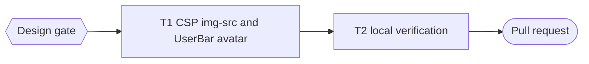

# Google Avatar CSP Implementation Plan

> For agentic workers: REQUIRED EXECUTION METHOD: inline plan execution (one CSP line and one component; see Execution).

**Goal:** Show the visitor's Google profile picture in the user bar.

**Architecture:** The live CSP is `img-src 'self' data: blob:` (served header read 2026-10-21), so the browser blocks Google avatar URLs on `lh3.googleusercontent.com` and the `` shows clipped alt text. The CSP gains `https://*.googleusercontent.com` for images only; `UserBar` renders a picture only for that host, sends no referrer, and falls back to the initial on a load error.

**Tech Stack:** Cloudflare Pages `_headers`, React 18, bun:test with Testing Library.

**Active Project Profile:** repository `/home/belajarcarabelajar/Proyek/time-capsule`, worktree `time-capsule-wt/google-avatar-csp`, branch `2026-10-21-google-avatar-csp/google-avatar-csp`, base `origin/main` at `bf13ada`. CI disabled by the owner; local gates only.

**Project Commands:** `cd apps/web && bun test src/components/__tests__/UserBar.test.jsx`; `bun run test:script`; `bun run --cwd apps/web lint`; `bun run build`.

**Protected Boundaries:** `scripts/build-website.test.js` requires `connect-src` to keep `'self'`, `blob:`, `https://cloudflareinsights.com`, `script-src` to keep `https://static.cloudflareinsights.com`, and the CSP never to contain `img-src self https:`.

**Spec:** none (Bounded path); design shown in chat.

**Scope:** the `img-src` directive; the `UserBar` avatar rule, `referrerPolicy`, and load-error fallback.

**Non-Goals:** proxying avatars through Pages Functions; changing other directives; storing pictures.

**Visual Map:**

**Reasoning Lenses:** investigative (served CSP header, `UserBar.jsx:72-78`, CSP since `3e79c85`), security (narrow host allowance, no referrer), user-centered (no clipped alt text), test-first, verification.

**Acceptance Criteria:**
- AC1: the served CSP `img-src` contains `https://*.googleusercontent.com` and still no bare `https:`.
- AC2: `UserBar` renders the picture only for an `https` URL on a `googleusercontent.com` host, with `referrerPolicy="no-referrer"`; any other URL shows the initial.
- AC3: when the picture fails to load, the initial circle replaces it.

**Traceability:** AC1 → `scripts/build-website.test.js`; AC2, AC3 → `UserBar.test.jsx`.

**Assumptions & Open Questions:** Google OpenID `picture` values are served from `*.googleusercontent.com` (observed host `lh3`); a different Google host would fall back to the initial instead of breaking.

**Dependencies & Impact:** `UserBar` is the only consumer of `user.picture` in the web app.

**Risks & Rollback:** low; revert the merge and redeploy Pages.

**Security & Compatibility:** images only, one Google user-content wildcard; script, connect, and frame rules unchanged.

**Operations & Rollout:** merge, then deploy Pages at its own gate; verify the served CSP header.

**CI/Review Gate:** local gates; documented self-review in the PR.

**Documentation:** none.

**Definition of Done:** T1 and T2 green with exit codes; PR open and registered.

**Plan Status & Version:** Approved, version 1.

**Reproducibility:** bun 1.4.3 locally; lockfile unchanged.

**Test Reliability:** render tests and a header file read; no network.

**Privacy & Data Governance:** `no-referrer` stops sending the page URL to Google when the avatar loads.

**Dependencies & Supply Chain:** none.

**UX States:** picture, no picture, rejected URL, load error.

**Persistent State & Artifact Storage:** N/A.

**Entity & Sourcing Verification:** served CSP read with `curl -D -` on 2026-10-21.

**Verification:** T2 commands and exit codes in the PR body.

## Global Constraints

- No em dash in any diff line or commit message; no co-author trailer.

### Task T1: CSP img-src and UserBar avatar

**Files:** Modify `apps/web/public/_headers`, `apps/web/src/components/UserBar.jsx`; Test `scripts/build-website.test.js`, `apps/web/src/components/__tests__/UserBar.test.jsx`.
- [ ] Step 1: RED tests for AC1 to AC3 | cmd: `cd apps/web && bun test src/components/__tests__/UserBar.test.jsx` | expect: exit 1
- [ ] Step 2: change the CSP line and `UserBar` | expect: same command exit 0, `bun run test:script` exit 0
- [ ] Step 3: Commit (parent) by explicit path.

### Task T2: local verification

- [ ] Step 1: run the `run[]` commands and record exit codes in the PR body.

## Execution

Inline, by the parent: one CSP line and one component change with their tests (AGENTS.md A24).

## Session checklist

- [x] Design and plan approved at the `Design` gate. Evidence: `Design` answered "Approve design" 2026-10-21; runner validation exit 0.
- [x] T1: RED then GREEN with the CSP and UserBar tests. Evidence: RED UserBar exit 1 (3 fail: referrer, host, onError), `test:script` exit 1 (CSP img-src); GREEN UserBar exit 0, 13 pass, `test:script` exit 0, 13 pass; commit `1f6c393`.
- [x] T2: local gates exit 0. Evidence: UserBar and App tests exit 0, 20 pass; lint exit 0, 0 warnings; build exit 0; `test:client-assets` exit 0; `dist/_headers` contains `googleusercontent`; copy rules exit 0.
- [ ] Deliver: PR opened through `pr-registry.mjs open`.
- [ ] Merge and deploy Pages, each at its own gate.

## Approval

| Gate | Answer | Date |
|---|---|---|
| `Design` | Approve design | 2026-10-21 |
