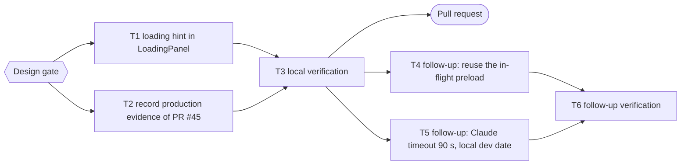

# Story Loading Hint Implementation Plan

> For agentic workers: REQUIRED EXECUTION METHOD: inline plan execution (one component and its test; see Execution).

**Goal:** Tell the visitor how long a chapter takes while Claude writes it, so the roughly 30 second wait no longer looks stuck.

**Architecture:** `LoadingPanel` (shared by the start screen and the gameplay screen) gains a `hint` prop with a default estimate line rendered under the existing subtitle. No logic, timer, or API change.

**Tech Stack:** React 18 in `@time-capsule/ui`, bun:test with `react-test-renderer`.

**Active Project Profile:** repository `/home/belajarcarabelajar/Proyek/time-capsule`, worktree `time-capsule-wt/story-loading-hint`, branch `2026-10-21-story-loading-hint/story-loading-hint`, base `origin/main` at `38ded6e`. CI is disabled by the owner (2026-10-21), so every gate runs locally.

**Project Commands:** `cd packages/ui && bun test src/components/LoadingPanel.test.jsx`; `cd apps/web && bun test <file>`; `bun run --cwd apps/web lint`; `bun run build`.

**Protected Boundaries:** the heading texts "MEMBUKA PORTAL WAKTU...", "MEMBUKA PORTAL SEJARAH...", and "MENYIAPKAN BABAK BERIKUTNYA..." stay unchanged (asserted by `LoadingPanel.test.jsx` and `StartScreen.test.jsx`).

**Spec:** none (Bounded path); the design was shown in chat and approved at the `Design` gate.

**Scope:** the estimate line in `LoadingPanel`; recording the production evidence of the previous session in its open plan.

**Non-Goals:** changing effort, timeout, or model; streaming; an elapsed-time counter; the duplicate request when a visitor continues before the preload finishes (debt sweep).

**Visual Map:**

**Reasoning Lenses:** intent (owner: "lama loadingnya"), investigative (measured 28 to 33 s per chapter at effort medium, two live requests 32.6 s and 33.1 s), user-centered (a wait with no estimate reads as stuck), test-first, verification.

**Acceptance Criteria:**
- AC1: the loading panel shows "AI sedang menulis babak ini. Biasanya butuh sekitar 30 detik." under the subtitle by default, on both screens.
- AC2: a caller can override the line through the `hint` prop; the heading texts stay unchanged.
- AC3: the previous plan records the T7 and T8 production evidence with the live-test result as measured, and stays open per its closeout trigger.

**Traceability:** AC1, AC2 → T1 → `LoadingPanel.test.jsx`, `StartScreen.test.jsx`; AC3 → T2 → runner validation of the previous plan.

**Assumptions & Open Questions:** "sekitar 30 detik" matches the measured 28 to 33 s; if the effort changes, the default text changes with it.

**Dependencies & Impact:** `LoadingPanel` consumers: `StartScreen.jsx:32`, `GameplayScreen.jsx:61`.

**Risks & Rollback:** cosmetic; revert the merge commit and redeploy Pages.

**Security & Compatibility:** none; static text.

**Operations & Rollout:** merge, then deploy Pages behind its own approval.

**CI/Review Gate:** local gates only (CI disabled); parent self-review documented in the PR.

**Documentation:** none beyond this plan.

**Definition of Done:** T1 to T3 green with exit codes, PR open and registered.

**Plan Status & Version:** InProgress (debt-sweep follow-ups T4 to T6), version 1.

**Reproducibility:** bun 1.4.3 locally, lockfile unchanged.

**Test Reliability:** pure render tests, no timers or network.

**Privacy & Data Governance:** N/A, no data.

**Dependencies & Supply Chain:** no dependency change.

**UX States:** loading state only; text is Indonesian like the rest of the UI.

**Persistent State & Artifact Storage:** N/A.

**Entity & Sourcing Verification:** timing from this repository's measurements on 2026-10-21 (`docs/code-plan/evidence/2026-10-21-claude-story-worker/production.md`).

**Verification:** T3 commands and exit codes in the PR body.

## Global Constraints

- No em dash in any diff line or commit message; no co-author trailer.

### Task T1: loading hint in LoadingPanel

**Files:** Modify `packages/ui/src/components/LoadingPanel.jsx`; Test `packages/ui/src/components/LoadingPanel.test.jsx`.
**Interfaces:** `LoadingPanel({ text, hint })`, `hint` defaults to the AC1 text.
- [x] Step 1: RED tests for the default hint and the override | cmd: `cd packages/ui && bun test src/components/LoadingPanel.test.jsx` | expect: exit 1
- [x] Step 2: add the `hint` prop and its paragraph | same command, expect: exit 0
- [x] Step 3: Commit (parent) by explicit path.

### Task T2: record production evidence of PR #45

**Files:** Create `docs/code-plan/evidence/2026-10-21-claude-story-worker/production.md`; Modify `docs/code-plan/plans/2026-10-21-claude-story-worker.md` (session checklist and closeout status only).
- [x] Step 1: write the deploy, binding, secret, `workers.dev`, analytics, and timing evidence as measured.
- [x] Step 2: tick the merge and deploy checklist items with that evidence; keep the plan open (T6 still blocked) | cmd: `bun $HOME/vivera/scripts/ultra-plan-runner.mjs docs/code-plan/plans/2026-10-21-claude-story-worker.md` | expect: exit 0
- [x] Step 3: Commit (parent) by explicit path.

### Task T3: local verification

- [x] Step 1: run the `run[]` commands and record exit codes in the PR body.

### Task T4: follow-up, reuse the in-flight preload

**Files:** Modify `apps/web/src/hooks/useGameState.js`; Test `apps/web/src/hooks/__tests__/useGameState.test.jsx`.
**Behavior & Acceptance:** continuing while the preload for that chapter is still running waits for it instead of requesting the chapter again; exactly one Claude request per chapter; the next continue never shows a duplicate of the chapter just shown.
- [x] Step 1: RED hook test with a pending preload | cmd: `cd apps/web && bun test src/hooks/__tests__/useGameState.test.jsx` | expect: exit 1
- [x] Step 2: track the in-flight preload in a ref and await it in `handleContinue` | same command, expect: exit 0
- [x] Step 3: Commit (parent) by explicit path.

### Task T5: follow-up, Claude timeout 90 s and local dev date

**Files:** Modify `apps/story-worker/src/claude.js`, `apps/story-worker/wrangler.jsonc`; Test `apps/story-worker/src/index.test.js`.
**Behavior & Acceptance:** the SDK timeout is 90000 ms (measured single attempts 28 to 33 s); `compatibility_date` is `2026-09-10` so `wrangler dev` starts with the bundled workerd.
- [x] Step 1: RED assertions for the timeout and the date | cmd: `bun test apps/story-worker/src/index.test.js` | expect: exit 1
- [x] Step 2: change both values; `wrangler dev` reaches `Ready on` | expect: test exit 0, `bun run --cwd apps/story-worker check` exit 0
- [x] Step 3: Commit (parent) by explicit path.

### Task T6: follow-up verification

- [x] Step 1: run the `run[]` commands and record exit codes in the PR body.

## Follow-up backlog (debt sweep 2026-10-21)

Selected: T4, T5. Deferred:

- 10 `AuthContext` web tests red on `main`. `defer: separate pull request per AGENTS.md A7, when the owner schedules it`.
- Prompt adherence: 1 of 5 medium scenarios ended on a quiz instead of the narrator slide; slides 19 to 27 against 15 to 20. `defer: an eval over 10 or more topics, before any prompt change`.
- Worker cold-start CPU 29.1 ms against the Workers Free 10 ms figure. `defer: watch Worker errors for exceededCpu, act on the first one`.
- A tail-captured `"outcome":"ok"` line from a browser request. `defer: the next time the owner plays with wrangler tail running`.
- Re-pass (found while executing T4): a preload still running when the visitor finishes and starts a new topic can land in the new topic's `nextGameData` (`apps/web/src/hooks/useGameState.js`, existed before T4). `defer: next change to the hook, with a reset test that clears the in-flight ref`.

## Execution

Inline, by the parent: one component with its test plus one documentation update, under a minute of work each; a subagent would only wrap a single step (AGENTS.md A24).

## Closeout status

- **Decision:** `Keep it open` (`Close plan` gate, 2026-10-21).
- **Readiness:** `bun ~/vivera/scripts/plan-closeout.mjs --readiness docs/code-plan/plans/2026-10-21-story-loading-hint.md` exit 3, `NEEDS-HUMAN` (2026-10-21): T1, T4, T5 `DONE`; T2, T3, T6 `UNPROVEN` (`skip_if: "false"`, runner `PASSED`); 0 open step boxes; 1 other open box (merge and deploy).
- **What remains:** merge PR #46, deploy the story Worker (timeout and date) and Pages (hint and preload fix), each at its own gate.
- **Reopen trigger:** the next session's PR records the merge and deploy evidence and decides `Complete`.

## Session checklist

- [x] Design and plan approved at the `Design` gate. Evidence: `Design` answered "Approve design" 2026-10-21; `ultra-plan-runner.mjs` exit 0.
- [x] T1: RED then GREEN of `LoadingPanel.test.jsx`. Evidence: RED exit 1 (`No instances found with props: {"data-testid":"loading-hint"}`, 2 fail); GREEN exit 0, 4 pass; commit `01651a6`.
- [x] T2: previous plan validates with the production evidence recorded. Evidence: `ultra-plan-runner.mjs docs/code-plan/plans/2026-10-21-claude-story-worker.md` exit 0; commit `8025fe0`.
- [x] T3: local gates exit 0. Evidence: ui `bun run test` exit 0, 59 pass; StartScreen and GameplayScreen tests exit 0, 12 pass; lint exit 0, 0 warnings; build exit 0; `test:client-assets` exit 0; `test:script` exit 0, 13 pass; hint text present in `apps/web/dist/assets/index-B3yIQd3d.js`; copy rules exit 0.
- [x] Deliver: PR opened through `pr-registry.mjs open`. Evidence: exit 0, `https://github.com/belajarcarabelajar/time-capsule/pull/46`, recorded PR #46 (open).
- [ ] Merge and deploy Pages, each at its own gate.

## Approval

| Gate | Answer | Date |
|---|---|---|
| `Loading` | Medium + loading hint | 2026-10-21 |
| `Design` | Approve design | 2026-10-21 |
