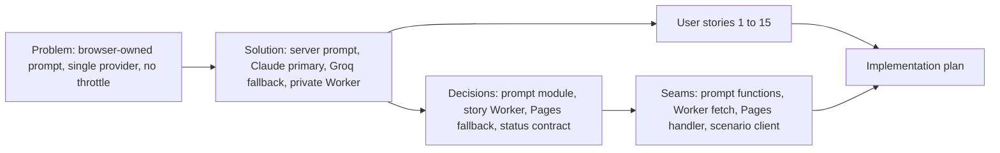

# Spec: Claude story Worker with Groq fallback

- **Status:** Approved (`Spec` gate, 2026-10-21)
- **Date:** 2026-10-21
- **Path:** Architectural (adds a new deployable subsystem and changes the browser-to-server scenario contract)
- **Related:** plan `docs/code-plan/plans/2026-10-21-claude-story-worker.md`; points accounting decision `docs/code-plan/points-accounting-decision.md`

## Problem Statement

Story chapters are generated by a single OpenAI-compatible provider (Groq). The owner wants Claude as the main storyteller, with the current provider kept only as a fallback.

The current endpoint is also an open model proxy. The browser assembles the whole prompt, including the system prompt, and the server forwards the browser's `messages`, `response_format`, and `max_tokens` unchanged. Any signed-in visitor can replace the system prompt, ask for unrelated output, and spend the provider budget on it. Provider error bodies are returned to the browser verbatim. Nothing limits how often one account, or all accounts together, can trigger a generation inside a minute.

## Solution

A visitor still types a historical topic and reads the same chapters, quizzes, and narrator insights. Behind the page:

- The browser sends only the topic, the chapter number, and the story so far. The server owns the prompt, the model, and the output format.
- Chapters are written by Claude Haiku 5.5 at medium effort, constrained to the scenario JSON shape.
- When Claude is unavailable (network, overload, expired key, cut-off output), the same server-built prompt goes to Groq, so the lesson keeps working.
- When Claude declines a topic on safety grounds, the visitor gets a clear "topic cannot be processed" message, no points are charged, and no other model is asked.
- Bursts are throttled: one account gets at most 6 generations per minute and the whole site at most 20 per minute in each Cloudflare location. A throttled visitor sees "too many requests, try again shortly".
- The Claude credential lives only in a private Worker that has no public URL.

## User Stories

1. As a visitor, I want my chapter written by Claude, so that the dialogue is richer and follows the scenario rules more closely.
2. As a visitor, I want the chapter to arrive even when Claude is down, so that a provider outage does not end my lesson.
3. As a visitor whose topic Claude declines, I want a short explanation and my points untouched, so that I can try another topic.
4. As a visitor who clicks quickly through chapters, I want preloading to keep working within the per-account limit, so that normal reading never hits the throttle.
5. As a visitor who hits the throttle, I want a message telling me to wait, so that I know the site is not broken.
6. As the owner, I want the browser unable to change the system prompt, model, token cap, or output format, so that the endpoint cannot be used as a general model proxy.
7. As the owner, I want text typed into the topic box or carried in the story history treated as data, so that instructions hidden there cannot change the storyteller's rules.
8. As the owner, I want generated output forced into the scenario shape, so that an injected instruction cannot turn the response into free text.
9. As the owner, I want provider errors logged by reason and status only, so that neither the visitor nor the logs see prompts, keys, or account identifiers.
10. As the owner, I want a site-wide per-minute cap, so that a compromised or scripted account cannot run up the Claude bill.
11. As the owner, I want the Claude key stored only as a Worker secret and in my local untracked environment file, so that it never reaches the browser bundle or the repository.
12. As the owner, I want the site to keep generating through the fallback when the Claude key expires on 2026-11-20, so that the expiry is an inconvenience, not an outage.
13. As the owner, I want generation to stop rather than bypass the throttle when the private Worker is missing or broken, so that the rate limit cannot be skipped.
14. As a developer, I want the prompt rules, request validation, and output schema in one pure shared module, so that the Pages Function and the Worker cannot drift apart.
15. As a developer, I want each provider path tested with injected fakes, so that no test calls a real provider or spends money.

## Implementation Decisions

- **Modules:**
  - *Scenario prompt module* (shared, pure, no I/O): validates a scenario request, sanitizes user text, builds the system and user prompt, and exports the scenario JSON schema for structured output. Used by both the Pages Function and the story Worker.
  - *Story Worker* (new deployable): validates again, applies both rate limiters, calls Claude through the official Anthropic SDK, and answers with a small status contract.
  - *Scenario Pages Function* (changed): authenticates, enforces the body size limit and the strict request schema, checks points, calls the story Worker through a service binding, falls back to Groq only on a fallback-eligible failure, then charges points and stores the story as today.
  - *Scenario client* (changed): sends the scenario request fields instead of a prompt; parsing, sanitizing, and Zod validation of the reply stay as they are.
- **Interfaces:**
  - Browser to Pages: request body is exactly `{topic, chapter, history}`. Topic is 1 to 200 characters after sanitizing, history at most 3000 characters, chapter an integer from 1 to 100. Any other key is rejected with 400. The success reply keeps the current shape `{success: true, result: {response}}`.
  - Pages to Worker: `POST /v1/story` with `{userId, topic, chapter, history}`, reachable only through the service binding.
  - Worker replies: 200 `{success: true, provider: "claude", response}`; 400 `INVALID_REQUEST`; 422 `REFUSED`; 429 `RATE_LIMITED`; 502 `PRIMARY_UNAVAILABLE` with a reason code (not configured, auth, rate limited upstream, overloaded, timeout, max tokens, invalid output, unknown).
- **Schema:** no database change. The stored story content becomes `{provider, response}` instead of the raw provider body, and the stored prompt snippet becomes the topic and chapter instead of the serialized messages.
- **Contracts:**
  - Fallback-eligible failure: only a Worker reply of 502 `PRIMARY_UNAVAILABLE`.
  - Terminal failures (no fallback, no charge): Worker 400, 422, 429; a missing service binding; a Worker that throws or answers with an unknown status.
  - Visitor-facing errors are fixed Indonesian messages; provider bodies and exception messages are never forwarded.
- **Architecture:**
  - A separate Worker holds the Claude key and the limiters because the Rate Limiting binding is documented for Workers and not for Pages Functions (Cloudflare docs read 2026-10-21), and because the Groq key exists only as an unreadable Pages secret, so the fallback stays in the Pages Function where that secret already lives.
  - Fail closed on Worker absence: availability yields to the guarantee that every generation passes the limiter.
  - Claude request: model `claude-haiku-5-5`, adaptive thinking, effort `medium`, structured output with the scenario JSON schema, `max_tokens` 16000 because thinking tokens count against it, cache control on the system block, 45 second timeout, one SDK retry. No sampling parameters (Haiku 5.5 rejects non-default values) and no server-side refusal fallback (Haiku 5.5 does not support it).
  - Prompt injection defenses: server-built prompt; strict request schema; control characters and `< > { } [ ]` removed from user text so the delimiter tags cannot be closed; user text wrapped in `<topik_pengguna>` and `<riwayat_cerita>` tags; a security block in the system prompt that declares tagged text to be data and redirects non-historical or harmful topics to the nearest safe historical scenario; output constrained by the JSON schema; client-side DOMPurify on rendered rich text stays.
  - Limits: per-account limiter 6 calls per 60 seconds keyed by the authenticated subject, site-wide limiter 20 calls per 60 seconds; both are per Cloudflare location and eventually consistent, as Cloudflare documents.
  - The Worker has `workers_dev` and preview URLs disabled and no route.

## Testing Decisions

- **What a good test is here:** it drives a public entry point (the Pages handler, the Worker `fetch`, `fetchScenarioData`, or an exported prompt function) with fakes for the providers, the limiter, and the binding, and fails when the observable status, body, fallback decision, or charge changes.
- **Seams:** existing handler-level seams for the Pages Function and the client; a new `fetch(request, env, deps)` seam for the Worker where `deps` injects the SDK `fetch`.

| Seam | What it catches | What it misses |
|---|---|---|
| Scenario prompt module functions | schema strictness, sanitizing, tag escaping, prompt rules per chapter, JSON schema shape | real model behaviour on injected text (covered by the manual smoke test) |
| Worker `fetch` with fake SDK fetch and fake limiters | status contract, refusal and max-tokens handling, limiter order, missing key, no leak of upstream text | real Cloudflare limiter accuracy and Free-plan availability (covered by the gated deploy) |
| Pages handler with fake binding, fake Groq fetch, Miniflare D1 | fallback decision table, fail-closed paths, body limit, charge only on success | real service binding wiring (covered by the gated deploy and smoke test) |
| `fetchScenarioData` with fake fetch | new request body, unchanged reply parsing, new 422 and 429 messages | rendering (covered by existing web tests) |

- **Prior art:** `functions/api/scenario.test.js` (Miniflare D1 fixture, admin token), `packages/game-engine/src/__tests__/scenarioClient.test.js`, `packages/game-engine/src/__tests__/accountingStatus.test.js`.

## Glossary

- **Primary provider:** Claude Haiku 5.5, called only by the story Worker.
- **Fallback provider:** the Groq OpenAI-compatible API, called only by the scenario Pages Function.
- **Story Worker:** the private Cloudflare Worker `time-capsule-story`, reachable only through the `STORY_WORKER` service binding.
- **Scenario request:** the browser's `{topic, chapter, history}` body.
- **Fallback-eligible failure:** a story Worker reply of 502 `PRIMARY_UNAVAILABLE`.
- **Terminal failure:** any failure that must not reach the fallback provider: refusal, rate limit, invalid request, auth, quota, or a missing or broken story Worker.

## Out of Scope

- Binding a D1 database to the production Pages project; today non-admin generations return 503 `POINTS_UNAVAILABLE`. Raised in the debt sweep.
- Removing the unused `VITE_CF_API_TOKEN` and `VITE_GEMINI_API_KEY` Pages secrets. Raised in the debt sweep.
- Storing story history on the server instead of trusting the browser's copy.
- A Claude spend limit in the Anthropic Console; that is an account setting for the owner.

## Further Notes

- Production steps run after merge, each behind its own approval: deploy the Worker, set the `ANTHROPIC_API_KEY` secret from the local untracked environment file, confirm the Worker has no public URL, add the `STORY_WORKER` service binding to the Pages production environment, deploy Pages, then a smoke test with `wrangler tail` while the owner plays one chapter.
- The Claude key expires 2026-11-20 18:44 GMT+7; afterwards the Worker answers `PRIMARY_UNAVAILABLE` with reason `auth` and Groq serves until a new key is set.
- Whether the Rate Limiting binding deploys on the Workers Free plan is not documented on the pages read; the Worker deploy proves it or fails loudly.

## Visual Map

## Approval

| Gate | Answer | Date |
|---|---|---|
| `Arsitektur` | Dedicated Claude Worker | 2026-10-21 |
| `Refusal` | Reject, no fallback | 2026-10-21 |
| `Rate limit` | 6/min user, 20/min global | 2026-10-21 |
| `Intent` | Lock intent | 2026-10-21 |
| `Section A` to `Section D` | Approve all four | 2026-10-21 |
| `Spec` | Approve spec | 2026-10-21 |
